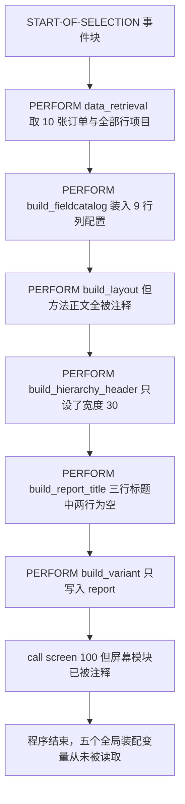
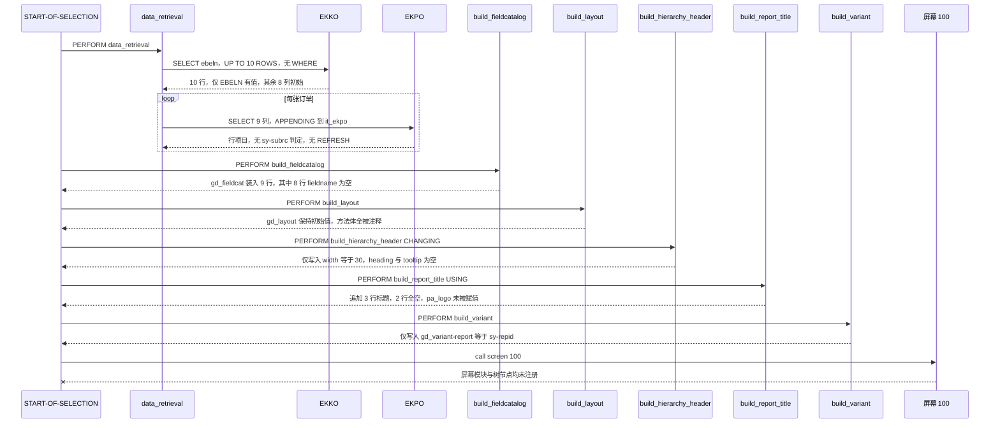

# ZALVTREE（zalvtree.abap）分析报告

## 一、程序定位与业务背景

**业务场景**：`ZALVTREE` 想演示的是 SAP 里很经典的一个 ALV 形态——**层级显示采购凭证**。采购订单是天然的"抬头加行项目"两层结构，把 `EKKO` 的订单号做成父节点、`EKPO` 的行项目做成子节点，采购员可以逐单展开看每一行的物料、数量、价格。这类演示在培训材料里常见，程序头注释 `*& Report ZALVTREE` 也说明它是个 demo，不是生产报表。

**为什么需要这样一个演示**：ALV Grid 只能展示一张平面表，看不出"这个订单下面挂着哪些行项目"。ALV Tree（`cl_gui_alv_tree`）把行项目挂成子节点，一眼就能看出订单的完整结构。这是 Grid 与 Tree 两种形态的分水岭案例。

**这份代码的真实状态**：它只写完了**数据的准备半程**。`data_retrieval` 把订单与行项目取了出来，五个 `build_*` 方法把字段目录、布局、层级标题、报表标题、变式都"建"好了——但**没有一个被交给显示函数**。程序里既没有 `cl_gui_alv_tree=>create_tree`，也没有 `REUSE_ALV_GRID_DISPLAY`，更没有 `build_node` 或 `display_node` 去注册节点。而本该提供这些代码的三行 `INCLUDE` 被整段注释掉了。

**这份代码的味道**：像一份从教程里拆下来的骨架。注释掉的 `INCLUDE` 是最大线索——教程版本里，屏幕模块与节点 FORM 都放在 `ZDEMO_ALVTREEO01`、`ZDEMO_ALVTREEI01`、`ZDEMO_ALVTREEF01` 三个程序里，这里把它们注释掉之后，剩下的是一个只有"取数加装配"、没有"显示"的半成品。

## 二、程序执行流程总览



**责任链**：

| 子程序 | 调用者 | 职责 |
|---|---|---|
| `START-OF-SELECTION` | 程序入口（执行时自动触发） | 依次调六个 `PERFORM`，最后 `call screen 100` |
| `data_retrieval` | `START-OF-SELECTION` | 取 10 张订单，再对每张订单取行项目 |
| `build_fieldcatalog` | `START-OF-SELECTION` | 往 `gd_fieldcat` 装 9 行列配置 |
| `build_layout` | `START-OF-SELECTION` | 本应设置 `gd_layout`，正文被整段注释 |
| `build_hierarchy_header` | `START-OF-SELECTION` | 填 `p_hierarchy_header` 的层级标题 |
| `build_report_title` | `START-OF-SELECTION` | 往 `pt_report_title` 追加三行标题，接收 `pa_logo` |
| `build_variant` | `START-OF-SELECTION` | 写 `gd_variant-report` |

共 7 个子程序，另有全局声明区。下面按这条流程，逐个子程序展开。

## 三、分组分析（按程序流程 / 子程序）

### 3.1 全局声明区：类型、内表与 ALV 对象

这一段决定了后面一切能不能跑起来，分六步看。

#### ① 程序头与行类型定义

```abap
REPORT ZALVTREE .

TABLES: ekko.
TYPE-POOLS: slis. "ALV Declarations

TYPES: BEGIN OF t_ekko,
ebeln TYPE ekpo-ebeln,
ebelp TYPE ekpo-ebelp,
statu TYPE ekpo-statu,
aedat TYPE ekpo-aedat,
matnr TYPE ekpo-matnr,
menge TYPE ekpo-menge,
meins TYPE ekpo-meins,
netpr TYPE ekpo-netpr,
peinh TYPE ekpo-peinh,
END OF t_ekko.
```

**做什么** — `TABLES: ekko.` 声明 `EKKO` 全表工作区，`TYPE-POOLS: slis.` 载入 SLIS 类型池；随后 `TYPES` 定义一个 9 字段行类型 `t_ekko`，字段全部取自 `EKPO`（`ebeln`、`ebelp`、`statu`、`aedat`、`matnr`、`menge`、`meins`、`netpr`、`peinh`）。

**为什么** — 行类型全部指向 `EKPO` 而不是 `EKKO`，是因为真正要展示的是行项目明细。`TYPE-POOLS` 是 SLIS 时代的标准做法，加载一次 `slis_t_listheader`、`slis_layout_alv` 等结构就能直接用。

**风险与改进** — `TABLES: ekko.` 声明了整张 `EKKO`（200 多字段）的全表工作区，但全文没有任何一处引用它，属于纯冗余声明，应删除。`t_ekko` 把 `EKPO` 的字段平铺成自定义类型而不是直接 `TYPE ekpo`，好处是能精确投影，代价是 `EKPO` 未来新增字段时这里不会自动跟上，需要人工同步。

#### ② 内表与工作区

```abap
DATA: it_ekko TYPE STANDARD TABLE OF t_ekko INITIAL SIZE 0,
it_ekpo TYPE STANDARD TABLE OF t_ekko INITIAL SIZE 0,
it_emptytab TYPE STANDARD TABLE OF t_ekko INITIAL SIZE 0,
wa_ekko TYPE t_ekko,
wa_ekpo TYPE t_ekko.

DATA: ok_code like sy-ucomm,
save_ok like sy-ucomm.
```

**做什么** — 声明两张行类型为 `t_ekko` 的标准内表 `it_ekko` 与 `it_ekpo`、一张从未使用的 `it_emptytab`，以及两个工作区 `wa_ekko` 与 `wa_ekpo`；再声明两个 OK Code 变量 `ok_code` 与 `save_ok`。

**为什么** — `it_ekko` 存订单抬头、`it_ekpo` 存行项目，两张表用同一个行类型可以省一份类型定义。`ok_code` 与 `save_ok` 是屏幕交互的标准搭配：PAI 模块记录 `ok_code`，`USER_COMMAND` 比较 `save_ok` 是否变化，从而避免每次按键都重复刷新。

**风险与改进** — 三张表都是 `STANDARD TABLE`，没有定义键，后续任何 `READ TABLE` 都会退化成线性查找。`it_emptytab`、`wa_ekpo` 全文零引用；`ok_code` 与 `save_ok` 只在声明处出现，因为本该读写它们的 PAI 与 `USER_COMMAND` 都在被注释掉的 `INCLUDE` 里——这三个变量现在是没有消费者的声明。这些是 demo 骨架的残留，不是刻意保留的设计。

#### ③ 字段目录与布局声明：`gd_fieldcat` 被声明了两次

```abap
DATA: fieldcatalog TYPE lvc_t_fcat WITH HEADER LINE.

DATA: gd_fieldcat TYPE lvc_t_fcat,
gd_tab_group TYPE slis_t_sp_group_alv,
gd_layout TYPE slis_layout_alv.
```

**做什么** — 第一条 `DATA` 用 `WITH HEADER LINE` 声明字段目录内表 `gd_fieldcat` 及其表头行 `fieldcatalog`；紧接着第二条 `DATA` 又显式声明了同名变量 `gd_fieldcat`，同时声明 `gd_tab_group` 与 `gd_layout`。

**为什么** — 这是"复制教程再改写"留下的形状：教程原版的变量名不同，改写时只改了表名没改头行名，于是 `WITH HEADER LINE` 的隐式表名与后面显式声明撞在一起。

**风险与改进** — **这是全程序最硬的一处问题：`gd_fieldcat` 在同一作用域内被声明两次，属于重复声明，编译期即报错，程序根本无法激活。** `WITH HEADER LINE` 会自动生成一个叫 `gd_fieldcat` 的表变量，与第二行的显式声明同名。修法是把第二条改成只声明 `gd_tab_group` 与 `gd_layout`：

```abap-fix
DATA: fieldcatalog TYPE lvc_t_fcat WITH HEADER LINE.

DATA: gd_tab_group TYPE slis_t_sp_group_alv,
gd_layout TYPE slis_layout_alv.
```

顺带一提，`WITH HEADER LINE` 这个语法在 7.40 之后已被标记为过时（`WARNING` 级别），新代码应写成两张独立内表加一个工作区，而不是靠编译器隐式生成表名。

#### ④ Tree 类加载与 ALV Tree 对象

```abap
CLASS cl_gui_column_tree DEFINITION LOAD.
CLASS cl_gui_cfw DEFINITION LOAD.

DATA: gd_tree TYPE REF TO cl_gui_alv_tree,
gd_hierarchy_header TYPE treev_hhdr,
gd_report_title TYPE slis_t_listheader,
gd_logo TYPE sdydo_value,
gd_variant TYPE disvariant.
```

**做什么** — 载入 `cl_gui_column_tree` 与 `cl_gui_cfw` 两个类的定义，然后声明树对象 `gd_tree`（类型 `cl_gui_alv_tree`）、层级标题 `gd_hierarchy_header`、报表标题表 `gd_report_title`、Logo `gd_logo` 与变式 `gd_variant`。

**为什么** — `CLASS ... DEFINITION LOAD` 是把这些 GUI 类的结构定义带进当前程序，这样声明引用类型时才不用写全限定名。`treev_hhdr` 是 ALV Tree 专用的层级标题结构，与 Grid 的 `slis_layout` 不是一个东西。

**风险与改进** — **这里有一处引用与加载不匹配**：`gd_tree` 的类型是 `cl_gui_alv_tree`，但全文 `CLASS ... LOAD` 的是 `cl_gui_column_tree` 与 `cl_gui_cfw`，**`cl_gui_alv_tree` 从未被载入**。它能否解析取决于该程序是否在别处被 `DEFINE` 或通过包加载——这一点需要在 SE80 / SRU 里核实，不能从源码断言。而反过来，被载入的 `cl_gui_column_tree` 与 `cl_gui_cfw` 全文零引用：`cl_gui_cfw` 是真实存在的标准类但用不到；`cl_gui_column_tree` 是否是目标系统里真实存在的类，需要回 SE80 核实，若不存在则这行 `LOAD` 的意义为零。两个方向都是死代码，建议只保留真正被引用的类加载。

#### ⑤ 容器声明

```abap
DATA: l_tree_container_name(30) TYPE c,
l_custom_container TYPE REF TO cl_gui_custom_container.
```

**做什么** — 声明容器名字符串 `l_tree_container_name`（定长 30）与容器引用 `l_custom_container`。

**为什么** — ALV Tree 要显示在自定义屏幕 100 上，必须先建 `cl_gui_custom_container`，再把 `CONTAINER_NAME` 传给 `create_tree`。这两行是为那一步准备的。

**风险与改进** — 两个变量全文零引用：没有任何 `CREATE OBJECT l_custom_container`，也没有 `cl_gui_alv_tree=>create_tree`。它们的存在等于承认作者本来打算做"自定义屏幕加树"这条路线，但代码停在声明这一步。如果最终方案是标准的 `REUSE_ALV_GRID_DISPLAY`，这两行该删；如果要做 Tree，那这里缺的远不止两行。

#### ⑥ 被注释掉的 INCLUDE

```abap
*INCLUDE ZDEMO_ALVTREEO01. "Screen PBO Modules
*INCLUDE ZDEMO_ALVTREEI01. "Screen PAI Modules
*INCLUDE ZDEMO_ALVTREEF01. "ABAP Subroutines(FORMS)
```

**做什么** — 三行 `INCLUDE` 被 `*` 注释掉，分别对应屏幕 PBO 模块、PAI 模块与 FORM 子程序。

**为什么** — 这是把教程程序改成独立单文件时留下的痕迹：教程把屏幕逻辑与节点 FORM 拆在三个 include 程序里，改成单文件时应该把内容贴进来，而不是注释掉引用。

**风险与改进** — 这三行注释就是整份程序所有"缺东西"的总根源：屏幕 100 的 PBO 与 PAI 模块、`INITIALIZATION`、`USER_COMMAND`、以及建树必需的 `build_node` 与 `display_node` 都在里面。注释掉之后，`call screen 100` 指向一个不存在的屏幕，`ok_code` 与 `save_ok` 变成无消费者的声明，`gd_tree` 没有任何创建语句。如果决定保留单文件形态，需要把这三个 include 的实际内容合并进来；如果它们本应随包部署，就应该恢复引用而不是注释。

### 3.2 `START-OF-SELECTION`：装配与调用

```abap
START-OF-SELECTION.

* ALVtree setup data
PERFORM data_retrieval.
PERFORM build_fieldcatalog.
PERFORM build_layout.
PERFORM build_hierarchy_header CHANGING gd_hierarchy_header.
PERFORM build_report_title USING gd_report_title gd_logo.
PERFORM build_variant.

* Display ALVtree report
call screen 100.
```

**做什么** — 依次执行六个 `PERFORM`：`data_retrieval` 取数，`build_fieldcatalog` 装配字段目录，`build_layout` 装配布局，`build_hierarchy_header` 以 `CHANGING` 传入 `gd_hierarchy_header`，`build_report_title` 以 `USING` 传入 `gd_report_title` 与 `gd_logo`，`build_variant` 装配变式；最后 `call screen 100`。

**为什么** — 前六个 `PERFORM` 是纯粹的"准备工作"，全部围绕 `START-OF-SELECTION` 这一个全局作用域展开，顺序上没有依赖关系，所以可以并列写。这种"先装配、后显示"的结构是 ALV 报表的标准节奏。

**风险与改进** — 两步问题。**第一，最后一步是 `call screen 100`，但本文件里没有屏幕 100 的定义，也没有 `AT SCREEN 100` 或 `INITIALIZATION OF SCREEN 100`**，提供它们的正是被注释掉的两个 `INCLUDE`。执行到这里时，程序要么报"屏幕不存在"的运行时错误，要么直接停在原地——具体行为需要在 SE38 里执行一次确认，不能从源码断言。**第二，前面六步的全部产出（`gd_fieldcat`、`gd_layout`、`gd_hierarchy_header`、`gd_report_title`、`gd_variant`）没有任何一处被读取**：没有 `cl_gui_alv_tree=>create_tree`、没有 `REUSE_ALV_GRID_DISPLAY`、没有任何显示调用。六个方法的返回值全部被丢弃，这是一份只做了前 90% 工作的代码。

### 3.3 `data_retrieval`：取数，两步

这是整份程序唯一真正在取数据的地方，两步都要看。

#### ① 外层 SELECT：没有 WHERE，截断 10 行

```abap
FORM data_retrieval.
SELECT ebeln
UP TO 10 ROWS
FROM ekko
INTO corresponding fields of TABLE it_ekko.
```

**做什么** — 从 `EKKO` 只取 `ebeln` 一列，限制最多 10 行，用 `INTO corresponding fields of TABLE it_ekko` 按字段名对应装入 `it_ekko`。

**为什么** — `UP TO 10 ROWS` 是 demo 的惯用手法：不接选择屏、不接权限，就用硬编码上限把数据量压到可控范围，保证演示在任何系统上都能在几秒内跑完。

**风险与改进** — 两处后果明确的问题。**第一，这条 SELECT 没有 `WHERE` 子句**，是对 `EKKO` 全表做扫描再截断，在千万级订单的系统中这是一次无索引的全表读；而 `UP TO 10 ROWS` 返回的是数据库扫描顺序里的前 10 行，对演示而言是随机的一批订单，用户无法控制看哪些。**第二，`it_ekko` 的行类型有 9 个字段，这里只 SELECT 了 `ebeln`**，其余 8 个字段全部保持初始值——后续任何依赖 `it_ekko` 其他字段的逻辑都会读到空值。建议至少把订单号区间做成选择条件。

#### ② 循环内 SELECT：N+1、无 `sy-subrc`、无 `REFRESH`

```abap
loop at it_ekko into wa_ekko.
SELECT ebeln ebelp statu aedat matnr menge meins netpr peinh
FROM ekpo
appending TABLE it_ekpo
where ebeln eq wa_ekko-ebeln.
endloop.
ENDFORM. " DATA_RETRIEVAL
```

**做什么** — 循环 `it_ekko` 的每张订单，对每张订单查一次 `EKPO` 的 9 个字段，用 `appending TABLE it_ekpo` 追加进 `it_ekpo`，条件是 `ebeln` 等于当前工作区的订单号。

**为什么** — 用 `APPENDING` 而不是 `INTO ... OF TABLE`，是为了让多张订单的行项目累计在同一张表里，后面建树时按 `ebeln` 分组即可。

**风险与改进** — 三个问题，第一个直接决定 demo 能不能出结果。**第一，循环内没有任何 `REFRESH it_ekpo`，`APPENDING` 会跨迭代累积**：第 2 张订单的行项目会接在第 1 张后面，`it_ekpo` 最终是一张混着 10 张订单行项目的大表——对平面报表无所谓，但对 Tree 是致命的，因为建树时按行项目分组会把所有订单的行挂到第一个节点下面。**第二，没有检查 `sy-subrc`**：一张订单如果没有任何行项目（刚建好还没录行项目，在真实业务里非常常见），这次 SELECT 返回 0 行，`it_ekpo` 里没有它——而 ALV Tree 的节点是靠子节点行触发的，父节点拿不到任何子节点就不会被创建，**这张订单在树里彻底消失**。这正是本程序最隐蔽的缺陷：它连"一张空订单该不该显示"这个问题都没处理。补齐的写法：

```abap-fix
LOOP AT it_ekko INTO wa_ekko.
  REFRESH it_ekpo.
  SELECT ebeln ebelp statu aedat matnr menge meins netpr peinh
    FROM ekpo
    INTO TABLE it_ekpo
    WHERE ebeln = wa_ekko-ebeln.
  IF sy-subrc = 0.
    APPEND LINES OF it_ekpo TO it_all.
  ENDIF.
ENDLOOP.
```

**第三，这是典型的 N+1 查询**：循环 10 次就发 10 条 SELECT。虽然 `EKPO` 上有 `EBELN` 索引、10 次代价不大，但如果上限改成 1000 或去掉 `UP TO`，这就变成 1000 条数据库往返。改成一次 `SELECT ... INTO TABLE ... WHERE ebeln IN s_ebeln` 就能合并。

### 3.4 `build_fieldcatalog`：9 行配置，只有 1 行有效

这个方法分三段看，问题的核心在第二段。

#### ① EBELN 列：唯一有字段名的一行

```abap
FORM build_fieldcatalog.
* Please not there are a number of differences between the structure of
* ALVtree fieldcatalogs and ALVgrid fieldcatalogs.
* For example the field seltext_m is replace by scrtext_m in ALVtree.

fieldcatalog-fieldname = 'EBELN'. "Field name in itab
fieldcatalog-scrtext_m = 'Purchase Order'. "Column text
fieldcatalog-col_pos = 0. "Column position
fieldcatalog-outputlen = 15. "Column width
fieldcatalog-emphasize = 'X'. "Emphasize (X or SPACE)
fieldcatalog-key = 'X'. "Key Field? (X or SPACE)
* fieldcatalog-do_sum = 'X'. "Sum Column?
* fieldcatalog-no_zero = 'X'. "Don't display if zero
APPEND fieldcatalog TO gd_fieldcat.
CLEAR fieldcatalog.
```

**做什么** — 往 `fieldcatalog` 里填第一列的六项：`fieldname` 设为 `'EBELN'`、`scrtext_m` 设为 `'Purchase Order'`、`col_pos` 为 0、`outputlen` 为 15、`emphasize` 为 `'X'`、`key` 为 `'X'`；`do_sum` 与 `no_zero` 两行被 `*` 注释；然后 `APPEND` 进 `gd_fieldcat` 并 `CLEAR` 工作区。

**为什么** — 方法开头那三行注释很关键：作者知道 ALV Tree 的字段目录结构与 Grid 不同，`seltext_m` 要换成 `scrtext_m`。`emphasize = 'X'` 让订单号列加粗，`key = 'X'` 声明它可作为排序键。

**风险与改进** — `fieldcatalog-key = 'X'` 与 `emphasize = 'X'` 同时开在 `EBELN` 上没有问题。但要注意：`key` 的语义是"这一列是排序键"，如果只有 `EBELN` 一列被标为 key，而 `gd_fieldcat` 里其他列没有，那么点击其他列标题时 ALV 不会按那列排序——不过这个后果在本程序里无关紧要，因为字段目录根本没被传给任何显示函数。

#### ② 其余 8 列：字段名与标题全部被注释

```abap
"fieldcatalog-fieldname = 'EBELP'."
"fieldcatalog-scrtext_m = 'PO Iten'."
fieldcatalog-outputlen = 15.
fieldcatalog-col_pos = 1.
APPEND fieldcatalog TO gd_fieldcat..
CLEAR fieldcatalog.
```

**做什么** — 对第 2 列，`fieldname` 与 `scrtext_m` 两行被 `"` 整行注释掉，只保留 `outputlen = 15` 与 `col_pos = 1`，然后追加进 `gd_fieldcat`。`STATU`、`AEDAT`、`MATNR`、`MENGE`、`MEINS` 五列是完全相同的模式。

**为什么** — 这是 `"` 注释的典型后果：`"` 在 ABAP 里是整行注释符，作者大概是复制了一行做调试，忘了删掉行首的引号。

**风险与改进** — **这是第二个最硬的问题**：`CLEAR fieldcatalog` 之后，`fieldname` 已经变成空字符串，随后的 `outputlen` 与 `col_pos` 只能填宽度与位置，**追加进去的行 `fieldname` 恒为初始值**。`gd_fieldcat` 最终有 9 行，其中 8 行的字段名是空的。字段目录的作用就是把内表列映射到显示列，空字段名映射不到任何一列——结果是这些列根本不会出现，或者（取决于显示函数对空 `FIELDNAME` 的处理方式）在运行时抛异常。具体是哪一种需要在 SE38 里执行确认；但"9 行配置只有 1 行有效"这一点从源码就能判。另外这一行还有 `APPEND fieldcatalog TO gd_fieldcat..`——**结尾是双句号**，全程序共 8 处同样的写法，`..` 在语句终结符之外多出一个空语句，能否通过编译取决于目标系统的语法检查级别，需要在 SE38 核实。

#### ③ NETPR 与 PEINH 列：连类型定义也被注释掉

```abap
"fieldcatalog-fieldname = 'NETPR'."
"fieldcatalog-scrtext_m = 'Net Price'."
fieldcatalog-outputlen = 15.
fieldcatalog-col_pos = 7.
"fieldcatalog-datatype = 'CURR'."
APPEND fieldcatalog TO gd_fieldcat..
CLEAR fieldcatalog.
```

**做什么** — 第 8 列（`col_pos` 7）`NETPR`，除了被注释的 `fieldname`、`scrtext_m` 之外，还多注释掉了 `fieldcatalog-datatype = 'CURR'`，只留下宽度与位置。

**为什么** — 作者显然是想给净价列指定货币类型 `CURR`，好让 ALV 按货币格式显示小数位。

**风险与改进** — 这行注释掉反而是**歪打正着的正确**：`lvc_fcat` 的货币列要显示对，除了 `datatype = 'CURR'` 还必须同时给 `decpos_out`（或 `decimals_out`）指定小数位数，只设 `datatype` 会得到系统默认的小数位。`PEINH`（`col_pos` 8）是同一模式，只是没有 `datatype` 那行。所以这一整块即便全部解开注释，`NETPR` 的显示仍然是错的。正确做法是 `datatype`、`decpos_out`、`scrtext_m` 三件套一起给出。

### 3.5 `build_layout`：方法存在，正文全被注释

```abap
FORM build_layout.
"gd_layout-no_input = 'X'."
"gd_layout-colwidth_optimize = 'X'."
"gd_layout-totals_text = 'Totals'(201)."
* gd_layout-totals_only = 'X'.
* gd_layout-f2code = 'DISP'. "Sets fcode for when double
* "click(press f2)
"* gd_layout-zebra = 'X'.
"* gd_layout-group_change_edit = 'X'.
"* gd_layout-header_text = 'helllllo'.
ENDFORM. " BUILD_LAYOUT
```

**做什么** — 方法体只有 `FORM` 头与 `ENDFORM` 尾，中间 9 行全部被注释——3 行是 `"` 注释，6 行是 `*` 注释（其中 3 行的 `*` 后面又跟了一个 `"`，属于两种注释符叠写）。方法执行完后 `gd_layout` 保持初始值。

**为什么** — 注释掉的内容看得出作者曾经考虑过一整套交互选项：禁止输入、列宽自适应、合计行文本、双击触发 `DISP`、斑马纹、分组切换编辑、自定义表头。

**风险与改进** — 三处。**第一，`gd_layout` 最终是纯初始值**：没有 `no_input` 意味着 ALV 默认可输入，没有 `zebra` 意味着无斑马纹，没有 `f2code` 意味着双击无动作——全部落回默认行为，而不是"作者想要的行为"。对于一份要交差的 demo，"默认"和"设计过"的区别是看不出来的，这正是这种注释方式的危险之处。**第二，`totals_text = 'Totals'(201)` 用的是文本符号 201**，这要求程序的文本编辑器里维护了 001、002…201 共两百多条文本；如果该程序文本里根本没有 201 这个符号，这行解开注释会在编译或运行时暴露"文本符号不存在"。这个符号编号需要在 SE38 文本编辑器里核实。**第三，`"* gd_layout-zebra = 'X'.` 这种"星号加引号"的叠写注释**在 SE38 里无法再作为代码恢复，因为整行已经是注释，`"` 只是注释文本的一部分——如果当初只是想临时屏蔽，这种写法会让恢复变得困难。

### 3.6 `build_hierarchy_header`：9 行方法，只有 1 行有效

```abap
FORM build_hierarchy_header CHANGING
p_hierarchy_header TYPE treev_hhdr.

"p_hierarchy_header-heading = 'Hierarchy Header'(013)."
"p_hierarchy_header-tooltip = 'This is the Hierarchy Header !'(014)."
p_hierarchy_header-width = 30.
"p_hierarchy_header-width_pix = ''."
ENDFORM. " build_hierarchy_header
```

**做什么** — 方法接收一个 `CHANGING` 参数 `p_hierarchy_header`（类型 `treev_hhdr`），只设置 `width = 30`；`heading`、`tooltip` 与 `width_pix` 三行全部被注释。

**为什么** — `treev_hhdr` 是 ALV Tree 的层级标题结构，用来定义树左列那一列的标题与宽度。作者原本想用文本符号 013 和 014 给出标题与提示。

**风险与改进** — **树左列的标题将是空的**。`heading` 决定用户在树的第一列看到什么列头文字，这里注释掉之后该列没有标题；`tooltip` 也没有，鼠标悬停无提示。方法剩下的唯一效果是把宽度设成 30 字符。这和 `build_layout` 是同一个形状：方法还在，内容没了，调用者看不出来。**更值得警惕的是 `width` 与 `width_pix` 的关系**：`width` 按字符数计，`width_pix` 按像素计，两个都设会以像素为准；这里只设了字符数，在不同字体和大小的屏幕上列宽会浮动。如果这是给人看的演示界面，宽度应该设死。

### 3.7 `build_report_title`：三行标题，两行是空的

这个方法接收两个 `CHANGING` 参数，往 `pt_report_title` 追加三行，接收 `pa_logo` 但从未使用。

#### ① 声明与列表头

```abap
FORM build_report_title CHANGING
pt_report_title TYPE slis_t_listheader
pa_logo TYPE sdydo_value.

DATA: ls_line TYPE slis_listheader,
ld_date(10) TYPE c.
```

**做什么** — 方法接收 `pt_report_title`（`slis_t_listheader`，标题行内表）与 `pa_logo`（`sdydo_value`，Logo 值），声明局部行工作区 `ls_line` 与定长 10 字符的日期字符串 `ld_date`。

**为什么** — ALV Tree 的标题区是"一行一行拼出来"的，每行有 `typ`（H 标题 / S 状态 / A 动作 / T 普通文本）、`key`、`info` 三个字段。用局部 `ls_line` 逐行填、逐行追加是标准写法。

**风险与改进** — `pa_logo` 用 `CHANGING` 传入，说明调用方期望方法把 Logo 填进去；但方法体里对 `pa_logo` **零引用**（见 ④），参数形同虚设。调用方 `build_report_title USING gd_report_title gd_logo` 传进来的是一个从未赋值的 `gd_logo`，所以标题区的 Logo 永远是空的。这种"参数接了但没用"在代码审查里比直接报错难发现得多。

#### ② 标题行：`typ` 与 `info` 都被注释掉

```abap
* List Heading Line(TYPE H)
CLEAR ls_line.
"ls_line-typ = 'H'."
* ls_line-key "Not Used For This Type(H)
"ls_line-info = 'PO ALVTree Display'."
APPEND ls_line TO pt_report_title.
```

**做什么** — `CLEAR ls_line` 清空工作区，然后 `typ = 'H'` 与 `info = 'PO ALVTree Display'` 两行被注释（一个用 `"`、一个用 `*`），`key` 那行本来也是注释并说明 H 类型不用 key；随后把一个**全空**的行追加进 `pt_report_title`。

**为什么** — 作者想加一行"H 类型"的大标题，写着 `PO ALVTree Display`。

**风险与改进** — 追加进内表的是 `CLEAR` 之后的全空行：`typ` 为空、`info` 为空。标题区按 `typ` 决定行的渲染方式，空 `typ` 的行通常被忽略或直接显示为空行——具体行为取决于显示函数，需要在 SE38 里执行确认。但结果是确定的：**用户看不到"PO ALVTree Display"这个标题**。注释掉 `typ` 而不是整行注释掉，是这类缺陷最容易出现的位置——代码看起来"在干活"，实际上什么都没干。

#### ③ 状态行：只留下 `info`

```abap
* Status Line(TYPE S)
ld_date(2) = sy-datum+6(2).
"ld_date+2(1) = '/'."
ld_date+3(2) = sy-datum+4(2).
"ld_date+5(1) = '/'."
ld_date+6(4) = sy-datum(4).

"ls_line-typ = 'S'."
"ls_line-key = 'Date'."
ls_line-info = ld_date.
APPEND ls_line TO pt_report_title.
```

**做什么** — 手工拼装日期字符串：`ld_date` 的第 1-2 位放月（`sy-datum+6(2)`），第 3-4 位放日（`sy-datum+4(2)`），第 6-9 位放年（`sy-datum(4)`），两个 `'/'` 分隔符被注释；然后 `typ = 'S'` 与 `key = 'Date'` 被注释，只把 `info` 设成拼好的字符串并追加。

**为什么** — 状态行本来应该显示"日期：MM/DD/YYYY"这样的键值对。作者选择自己拼接字符串而不是用 `CONDENSE` 或系统格式。

**风险与改进** — 两处。**第一，两个 `'/'` 被注释掉了**，拼出来的字符串是 `MMDDYYYY` 这 8 个字符加一个初始的第 5 位——用户看到的是 `10142026` 而不是 `10/14/2026`。这是"注释一行就改掉展示效果"的典型：注释看起来像局部屏蔽，实际改掉了输出。**第二，`ld_date(2) = ...` 这种带括号的赋值**是给定长字符串做偏移写入，`ld_date` 声明为 `TYPE c` 长度 10，`ld_date+6(4)` 写到第 7-10 位，字符串实际占位是 `MM` 空 `DD` 空 `YYYY`，共 10 字符——布局正确但可读性差，且 `'/'` 一被注释就错位。建议直接用 `WRITE sy-datum TO ld_date DD/MM/YYYY` 或 `|{ sy-datum DATE = DD/MM/YYYY }|`，格式与位置一次搞定，也不存在"注释分隔符"这种坑。

#### ④ 动作行与结束

```abap
* Action Line(TYPE A)
CLEAR ls_line.
"ls_line-typ = 'A'."
"CONCATENATE 'Report: ' sy-repid INTO ls_line-info SEPARATED BY space."
APPEND ls_line TO pt_report_title.
ENDFORM.
```

**做什么** — 再次 `CLEAR ls_line`，`typ = 'A'` 与 `CONCATENATE 'Report: ' sy-repid` 两行被注释，然后追加一个全空行，方法结束。

**为什么** — 动作行原本要显示"Report: ZALVTREE"这样的程序名提示。

**风险与改进** — 与 ② 完全同构：追加的是 `CLEAR` 之后的空行。`pt_report_title` 最终有三行，其中两行是全空的，唯一有内容的行是 ③ 那行且缺了 `typ` 与 `key`。整个标题区的实际效果是：**一行没有类型标记的裸日期字符串**。方法名叫 `build_report_title`，但它既没建标题、也没建 Logo（`pa_logo` 零引用），只产出一个位置正确的日期行。方法名与行为严重不符，读者会以为这里有完整标题。

### 3.8 `build_variant`：一行代码，产出无人使用

```abap
form build_variant.
* Set repid for storing variants
gd_variant-report = sy-repid.
endform. " BUILD_VARIANT
```

**做什么** — 方法只做一件事：把 `gd_variant-report` 设为当前程序名 `sy-repid`。

**为什么** — `disvariant` 结构有三个主要字段 `report`、`program`、`variant`，设置 `report` 是变式保存/调用的第一步，通常紧跟着 `gd_variant-variant = 'xxx'`。

**风险与改进** — 只设了 `report`，`variant` 从未赋值，所以这个结构永远指向"没有具体变式"的状态。更关键的是 `gd_variant` 全文只有这一处赋值、零处读取——没有 `REUSE_ALV_GRID_DISPLAY` 之类的显示函数会消费它。这一行方法存在的唯一效果是给一个全局变量赋了个值然后被丢弃。可以整个删掉，或者补上 `variant` 字段并接上显示函数。

## 四、执行流程全景图（数据视角）



数据在这条链上的实际状态：`it_ekko` 有 10 行但只有订单号，`it_ekpo` 是所有订单行项目的累积混合，`gd_fieldcat` 有 9 行但 8 行没有字段名，`gd_layout` 是空的，`gd_hierarchy_header` 只有宽度，`gd_report_title` 三行里两行全空，`gd_variant` 只有程序名。这七个变量的产出**全部停在内存里，没有一处被读取**。

## 五、问题清单与改进建议（按优先级）

### 🔴 P0 业务正确性

| 编号 | 问题 | 所在 | 业务后果 |
|---|---|---|---|
| P0-1 | `gd_fieldcat` 在同一作用域被声明两次：`WITH HEADER LINE` 隐式生成一个表名，第二行又显式声明同名变量 | 全局声明区 | 重复声明在编译期即报错，程序无法激活，整份代码一行都跑不起来 |
| P0-2 | 9 行列配置中 8 行的 `fieldname` 与 `scrtext_m` 被 `"` 注释，`CLEAR` 之后只填宽度与位置 | `build_fieldcatalog` | 字段目录里 8 行字段名为空，映射不到任何内表列，明细列不会显示或运行时抛异常 |
| P0-3 | 六个 `PERFORM` 的全部产出没有任何一处被显示函数消费 | `START-OF-SELECTION` | 树既未创建也未注册节点，程序运行完不产生任何输出，demo 目的完全落空 |
| P0-4 | 循环内 SELECT 无 `sy-subrc` 判定，且 `it_ekpo` 不在循环内 `REFRESH` | `data_retrieval` | 无行项目的订单拿不到子节点而在树里消失；多张订单的行项目混在同一张表，建树时全挂到第一个节点 |
| P0-5 | `call screen 100` 但屏幕 100 的 PBO/PAI 模块在三个被注释掉的 `INCLUDE` 里 | `START-OF-SELECTION` | 程序调用一个不存在的屏幕，运行到这一步即出错或停在原地 |

### 🟠 P1 健壮性

| 编号 | 问题 | 所在 | 业务后果 |
|---|---|---|---|
| P1-1 | 全文零处 `AUTHORITY-CHECK`，且 `SELECT` 无条件 | `data_retrieval` | 采购组织与供应商组之间无任何权限隔离：任何能运行该事务的用户都能越权看到全量订单分布，属典型的数据权限与 SoD 职责分离缺口 |
| P1-2 | `SELECT ... FROM ekko` 无 `WHERE`，靠 `UP TO 10 ROWS` 硬截断 | `data_retrieval` | 千万级订单系统上是一次全表扫描，且返回的是扫描顺序里的任意 10 张订单，用户无法选择 |
| P1-3 | `cl_gui_alv_tree` 被引用但从未 `LOAD`；`cl_gui_column_tree` 与 `cl_gui_cfw` 被 `LOAD` 但从未引用 | 全局声明区 | 类是否可解析依赖别的程序先加载，源码本身不自洽；两行 `LOAD` 是死代码 |
| P1-4 | `ls_line-typ` 三处赋值全部被注释，`pa_logo` 参数零引用 | `build_report_title` | 标题区没有类型标记，用户看不到大标题与程序名；Logo 永为空 |
| P1-5 | `heading` 与 `tooltip` 被注释，`build_hierarchy_header` 只剩 `width = 30` | `build_hierarchy_header` | 树第一列无标题、悬停无提示，只改了宽度 |
| P1-6 | `build_layout` 方法体 9 行全部注释，`gd_layout` 保持初始值 | `build_layout` | 布局回落到系统默认而非作者意图，可输入、无斑马纹、双击无动作 |

### 🟡 P2 性能与规范

| 编号 | 问题 | 所在 | 业务后果 |
|---|---|---|---|
| P2-1 | 循环内 SELECT 构成 N+1 查询，10 张订单发 10 条数据库语句 | `data_retrieval` | 去掉 `UP TO` 后数据库往返线性增长，应合并为一次 `WHERE ebeln IN` |
| P2-2 | 三张 `STANDARD TABLE` 均未定义键 | 全局声明区 | 任何 `READ TABLE` 都是线性查找，行数上去后明显变慢 |
| P2-3 | 8 处 `APPEND ... ..` 结尾双句号 | `build_fieldcatalog` | 多出空语句，能否通过取决于语法检查级别，需在 SE38 核实 |
| P2-4 | `TABLES: ekko.` 全表工作区、`it_emptytab`、`wa_ekpo`、`ok_code`、`save_ok`、`gd_tab_group`、`gd_tree`、`l_custom_container`、`l_tree_container_name` 全文零引用 | 全局声明区 | 十余处冗余声明，读者无法判断哪些是设计、哪些是残留 |
| P2-5 | 三代 ALV API 混用：`lvc_t_fcat` 属 LVC，`slis_t_listheader` 与 `slis_layout_alv` 属 SLIS，`treev_hhdr` 属 Tree | 全局声明区 | 三个 API 族的字段目录与布局结构互不兼容，混用后配置即使被消费也无法生效 |
| P2-6 | `build_report_title` 手工按偏移拼 `MM/DD/YYYY`，两个分隔符各自独立成行 | `build_report_title` | 注释掉任一行分隔符就静默改变输出，应用格式模板一次搞定 |

### 🟢 P3 可扩展性

| 编号 | 问题 | 所在 | 业务后果 |
|---|---|---|---|
| P3-1 | `ZDEMO_ALVTREEO01`、`ZDEMO_ALVTREEI01`、`ZDEMO_ALVTREEF01` 三个 `INCLUDE` 被注释而非合并进来，程序退化成半成品 | 全局声明区 | 屏幕 100 的 PBO/PAI 模块、`INITIALIZATION`、`USER_COMMAND` 与建树必需的节点 FORM 全部缺失 |
| P3-2 | 全文没有 `SELECTION-SCREEN`，取数只有 `UP TO 10 ROWS` 硬截断 | 全局声明区 | 查询范围完全不受调用者控制，返回的是数据库扫描顺序里的任意 10 张订单，`ekko` 上没有任何过滤条件可写，也无法复现特定订单 |
| P3-3 | `gd_variant` 只设 `report` 未设 `variant`，且产出无人使用 | `build_variant` | 变式机制形同虚设，无法让用户保存列配置 |
| P3-4 | `NETPR` 列 `datatype = 'CURR'` 被注释，且原本就缺 `decpos_out` | `build_fieldcatalog` | 货币列即便解开注释也显示不出正确小数位，需 `datatype` 与 `decpos_out` 配套 |
| P3-5 | 方法名与行为不符：`build_layout` 什么都不建，`build_report_title` 不建标题也不建 Logo | `build_layout` | 读者凭方法名推断会得出完全错误的结论，是交接期最大的误解来源 |

## 六、整体评价与启发

**优点**

1. **注释里有真见识。** `build_fieldcatalog` 开头三行点出 ALV Tree 与 Grid 的字段目录结构不同、`seltext_m` 要换成 `scrtext_m`，这是踩过坑才会写的话。作者知道自己在做什么，只是代码停在半路。
2. **结构分层清楚。** 取数、字段目录、布局、层级标题、报表标题、变式六个方法各管一段，`START-OF-SELECTION` 只做编排，没有把逻辑塞进事件块。这个骨架本身是对的。
3. **参数方向正确。** `build_hierarchy_header` 用 `CHANGING` 传 `treev_hhdr`，`build_report_title` 用 `CHANGING` 传标题表与 Logo，接口的形状符合 ALV Tree 的用法。

**短板**

1. 整份程序只有取数是真正在跑的，其余六段都在"声明加注释"之间来回。
2. 一个重复声明就让编译直接失败，属于零成本就能查出的硬伤。
3. 大量 `"` 与 `*` 注释掉的方法体，让方法名成了误导源：`build_layout` 什么都不建，`build_report_title` 不建标题。
4. 注释掉三个 `INCLUDE` 而不是合并进来，等于把演示的关键一半删掉，却留下全部引用。

**可学到的设计经验**

1. **`"` 注释是最危险的一种"临时屏蔽"。** 它让代码看起来还在执行，实际已经静默失效——`build_report_title` 的三行标题就是这样消失的。需要临时屏蔽时，宁可整段删掉再加注释说明，也不要留一个会骗过读者的空转方法。
2. **方法名必须与行为一致。** 当 `build_layout` 的方法体被清空时，就该把它改名或删除；否则下一个读到它的人会以为布局是设计过的。方法名是一份承诺。
3. **`WITH HEADER LINE` 会隐式生成表名，与同作用域的其他声明可能撞名。** 这是重复声明的高发位置，新代码应显式声明工作区与内表。
4. **半成品要标注成半成品。** 三个 `INCLUDE` 注释掉之后，程序头就该写一行说明"本文件缺少屏幕模块与节点 FORM"，否则这份代码会在交接时被人当成完整 demo 传下去——这比直接报错危险得多。
