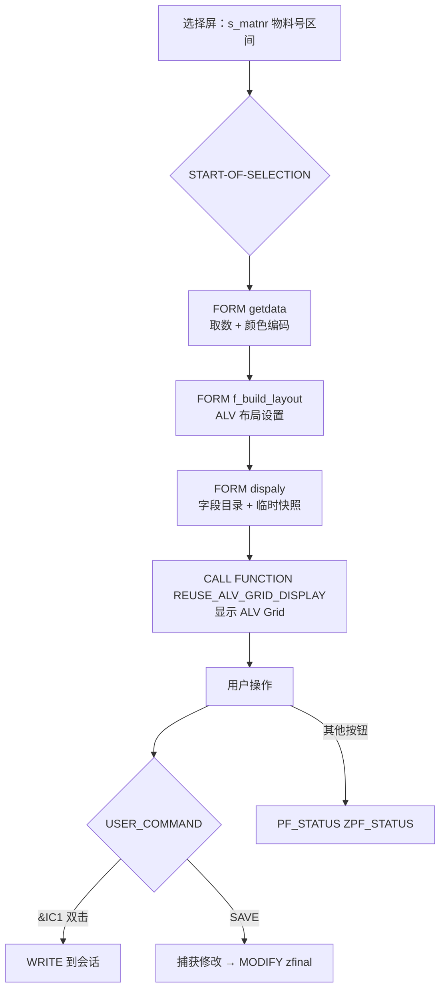
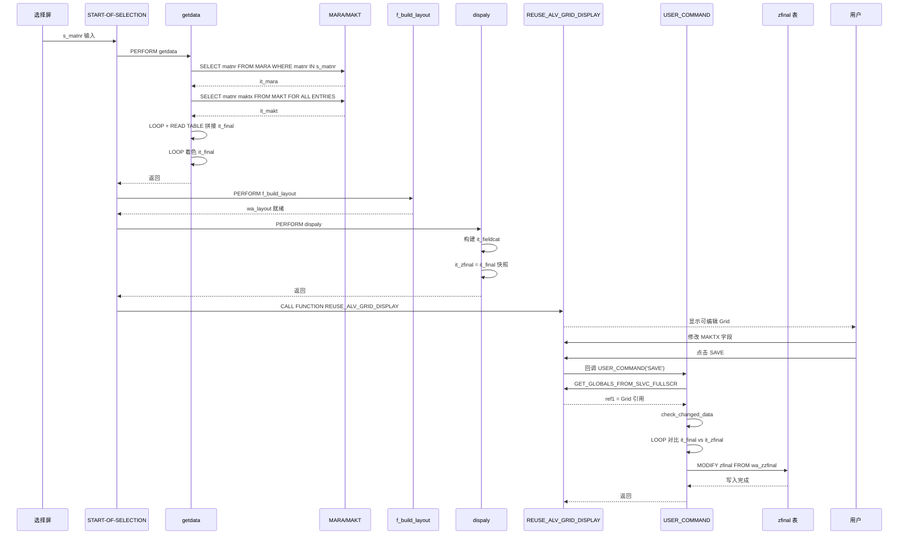

# zr 程序分析报告

## 一、程序定位与业务背景

`zr` 是一个 **SLIS ALV 物料查询与描述维护报表**。它的业务场景是：用户通过事务码执行后，在选择屏输入物料号区间，程序从 `MARA`（物料主数据）和 `MAKT`（物料描述）取数，以可编辑的 ALV Grid 形式展示，并允许用户在界面修改物料描述后点击 SAVE 写回 `zfinal` 表。

整体设计范式是 **SLIS ALV + 全局变量回调** 的早期经典写法（1998-2005 年间的典型模式），使用 `REUSE_ALV_GRID_DISPLAY` 而非 OOP 的 `CL_GUI_ALV_GRID` 或 `CL_SALV_TABLE`。

---

## 二、程序执行流程总览



| 子程序 | 调用者 | 职责 |
|--------|--------|------|
| `START-OF-SELECTION` | 选择屏执行 | 编排三个 FORM 的调用顺序 |
| `getdata` | START-OF-SELECTION | 从 MARA/MAKT 取数，拼接最终表，按条件给 MATNR 着色 |
| `f_build_layout` | START-OF-SELECTION | 设置 ALV 列宽优化与颜色列名 |
| `dispaly` | START-OF-SELECTION | 构建字段目录，为 SAVE 对比准备临时快照 |
| `USER_COMMAND` | ALV 回调 | 处理双击与保存两个按钮逻辑 |
| `PF_STATUS` | ALV 回调 | 设置自定义状态栏 `ZPF_STATUS` |
| `f_build_layout` | START-OF-SELECTION | 布局初始化（与上方同名，为同一 FORM） |

下面按这条流程，逐个子程序展开。

---

## 三、分组分析

### 3.1 事件块 `START-OF-SELECTION`

```abap
START-OF-SELECTION.
      PERFORM : getdata.
      PERFORM: f_build_layout .
      PERFORM: dispaly.
```

**做什么** — 选择屏执行后按固定顺序调用三个 FORM：先取数（`getdata`），再设置 ALV 布局（`f_build_layout`），最后构建字段目录（`dispaly`）。

**为什么** — 顺序有依赖：`dispaly` 需要 `it_final` 已有数据才能做临时快照（`it_zfinal[] = it_final[]`），`f_build_layout` 设置的 `wa_layout` 必须在 `CALL FUNCTION` 之前完成。但这个编排没有注释说明依赖关系，后续维护者如果调整顺序会不知道原因。

**风险与改进** — 三个 PERFORM 之间没有错误检查：如果 `getdata` 因为 `it_mara` 为空而 `LEAVE TO CURRENT TRANSACTION`（第 64 行），后面两个 FORM 不会执行——这是正确行为，但 `dispaly` 中的 `it_zfinal` 也不会被初始化。如果未来有人在 `getdata` 和 `f_build_layout` 之间插入了可能提前退出的逻辑，`dispaly` 的快照就会基于不完整的数据。建议在调用前加 `IF it_final IS INITIAL. RETURN. ENDIF.` 作为防御。

---

### 3.2 FORM `getdata`

#### ① 从 MARA 取物料号

```abap
SELECT matnr FROM mara INTO TABLE it_mara WHERE matnr IN S_matnr.
```

**做什么** — 按选择屏区间 `s_matnr` 从 `MARA` 表取物料号一列装进 `it_mara`。

**为什么** — 只取 MATNR 一列而非整行，避免把 MARA 的 200+ 字段搬进内存。MATNR 是 MARA 的客户端字段，上有索引。

**风险与改进** — `s_matnr` 不是必填项，等于允许全表扫描。MARA 是主数据表，全表扫描在大型系统上会严重影响性能。建议在 `getdata` 开头加 `IF s_matnr IS INITIAL. MESSAGE '请选择物料号区间' TYPE 'E'. LEAVE TO CURRENT TRANSACTION. ENDIF.` 拦截空选择屏。

#### ② 从 MAKT 取物料描述

```abap
IF it_mara IS NOT INITIAL.
SELECT matnr maktx FROM makt INTO TABLE it_makt
FOR ALL ENTRIES IN it_mara WHERE matnr = it_mara-matnr AND spras = 'EN'.
ENDIF.
```

**做什么** — 以 `it_mara` 中的物料号为键，用 `FOR ALL ENTRIES` 从 `MAKT` 取 MATNR 和 MAKTX，语言硬编码为 `'EN'`。

**为什么** — `FOR ALL ENTRIES` 避免逐行 SELECT，利用 MAKT 的 MATNR+SPRAS 索引前缀做半连接扫描。

**风险与改进** — 三处：(1) `spras = 'EN'` 硬编码语言，非英文环境的用户看到的描述会是空的或英文——应改为 `sy-langu` 或用户会话语言。(2) `FOR ALL ENTRIES` 在未判空的 `it_mara` 上执行会报短转储，虽然有 `IF it_mara IS NOT INITIAL` 保护，但如果未来有人删除这个 IF 就会出问题。(3) MAKT 的多语言存储意味着同一物料可能有多种语言描述，只取 EN 会丢失其他语言数据。

#### ③ 拼接最终表

```abap
LOOP AT it_mara INTO wa_mara.
wa_final-matnr = wa_mara-matnr.
READ TABLE it_makt INTO wa_makt WITH KEY matnr = wa_mara-matnr.
wa_final-maktx = wa_makt-maktx.
wa_final-matnr = wa_mara-matnr.
APPEND wa_final TO it_final.
ENDLOOP.
```

**做什么** — 遍历 `it_mara`，对每个物料号从 `it_makt` 读出描述，拼成 `wa_final` 追加到 `it_final`。

**为什么** — 两次 SELECT 的结果需要按 MATNR 做半连接，`READ TABLE ... WITH KEY` 是最直接的关联方式。

**风险与改进** — `wa_final-matnr = wa_mara-matnr` 在第 55 行和第 58 行重复赋值，第 58 行是冗余的。(2) `READ TABLE it_makt` 如果找不到对应描述（MAKT 里没有该物料），`sy-subrc` 非 0 但 MAKTX 不会被清空——`wa_final-maktx` 会残留上一次循环的旧值，导致描述串行。应在 `READ TABLE` 后加 `IF sy-subrc <> 0. CLEAR wa_makt. ENDIF.` 或在循环开头 `CLEAR wa_final`。(3) `it_makt` 是标准表（未指定键），`READ TABLE ... WITH KEY` 退化为线性查找，数据量大时是 O(n²)。

#### ④ 空结果处理

```abap
IF it_final IS INITIAL.
  MESSAGE 'no values' TYPE 'I'.
  LEAVE TO CURRENT TRANSACTION.
  ENDIF.
```

**做什么** — 如果最终表为空，提示用户并退出。

**为什么** — 选择屏区间可能不匹配任何物料，提前退出避免后续无效操作。

**风险与改进** — `LEAVE TO CURRENT TRANSACTION` 是硬退出，在后台批处理模式下会直接终止整个事务码执行。如果这个程序被调度为批处理作业，空结果会导致作业失败。建议在批处理场景下改用 `CONTINUE` 或静默返回。

#### ⑤ 颜色编码

```abap
LOOP AT it_FINAL INTO wa_FINAL.
  lv_index = sy-tabix.
  IF  wa_final-matnr+0(1) = '0'.
  wa_cellcolor-fname = 'MATNR'.
  wa_cellcolor-color-col = 6.
  wa_cellcolor-color-int = '1'.
  wa_cellcolor-color-inv = '0'.
  APPEND wa_cellcolor TO wa_FINAL-cellcolor.
  CLEAR: wa_cellcolor.
  MODIFY it_final FROM wa_final INDEX lv_index TRANSPORTING cellcolor.
  CLEAR wa_final.
    ENDIF.
   ENDLOOP.
```

**做什么** — 遍历最终表，物料号以 `0` 开头的行给 MATNR 字段上红色（color-col = 6，红色），修改对应行的 cellcolor 内表。

**为什么** — 在 SAP 中，物料号以 `0` 开头通常表示虚拟物料或特殊类别，着色是为了让审计人员在 ALV 中快速识别异常物料。

**风险与改进** — 四处：(1) `color-col = 6` 是红色，`color-int = '1'` 表示高亮——组合起来是红色高亮，但对红绿色盲用户不可区分。建议改用 `color-col = 4`（蓝色）或 `color-inv = '1'`（反色）增强可访问性。(2) 着色规则硬编码为 `matnr+0(1) = '0'`，没有注释说明业务含义——如果未来业务规则变化（比如要标出以 `T` 开头的测试物料），需要改代码而不是配置。(3) `MODIFY ... TRANSPORTING cellcolor` 修改的是同一行的内表字段，效率低于在 LOOP 前直接构建完整的 cellcolor 内表。

---

### 3.3 FORM `f_build_layout`

```abap
CLEAR wa_layout.
wa_layout-colwidth_optimize = 'X'.
wa_layout-coltab_fieldname = 'CELLCOLOR'.
```

**做什么** — 设置 ALV 布局：列宽自动优化，颜色字段指向 `CELLCOLOR`。

**为什么** — `coltab_fieldname` 告诉 ALV 从最终表的哪个字段读取颜色信息，与 3.2 节 ⑤ 的着色逻辑配对。

**风险与改进** — 无显著风险。布局配置简洁明了。

---

### 3.4 FORM `dispaly`（字段目录构建 + 快照准备）

```abap
wa_fieldcat-tabname = 'IT_FINAL'.
wa_fieldcat-fieldname = 'MATNR'.
wa_fieldcat-seltext_m = 'Material'.

APPEND wa_fieldcat TO it_fieldcat.
CLEAR: wa_fieldcat.

wa_fieldcat-tabname = 'IT_FINAL'.
wa_fieldcat-fieldname = 'MAKTX'.
wa_fieldcat-seltext_m = 'Description'.
wa_fieldcat-edit ='X'.

APPEND wa_fieldcat TO it_fieldcat.
CLEAR: wa_fieldcat.

it_zfinal[] = it_final[].
```

**做什么** — 构建两列字段目录：MATNR（只读）和 MAKTX（可编辑），并将 `it_final` 整体复制到 `it_zfinal` 作为 SAVE 前的快照。

**为什么** — 字段目录决定 ALV 的列显示和编辑属性。临时快照用于 SAVE 时对比用户是否修改了描述。

**风险与改进** — (1) 字段目录中 `tabname = 'IT_FINAL'` 在 SLIS ALV 中不是必需的——当且仅当有多个来源表时才需要区分，这里只有一张表，多余的赋值增加了维护负担。(2) `it_zfinal` 的类型是 `ty_final`（含 cellcolor），但 `it_zfinal[] = it_final[]` 会把 cellcolor 也复制过去，而 SAVE 逻辑中只用 MATNR 和 MAKTX 做对比——cellcolor 的复制是浪费的内存。(3) 字段目录中 MAKTX 设为 `edit = 'X'`，但没有设置 `edit_mask` 或字符限制，用户可以输入任意长度的文本到 MAKTX 中，可能导致 `MODIFY zfinal` 时字段溢出。

---

### 3.5 FORM `USER_COMMAND`

#### ① 双击处理（&IC1）

```abap
WHEN '&IC1'.
  LOOP AT it_final INTO wa_final.
  READ TABLE it_final INTO wa_final WITH KEY matnr = wa_final-matnr.
  WRITE: / wa_final-matnr.
  ENDLOOP.
```

**做什么** — 双击 ALV 行时，遍历最终表，对每个物料号做 `READ TABLE` 然后 `WRITE` 到会话。

**为什么** — 原始意图大概是双击查看物料详情，但实现只是一个占位符式的日志输出。

**风险与改进** — (1) `READ TABLE it_final INTO wa_final WITH KEY matnr = wa_final-matnr` 在同一 LOOP 中用 `wa_final-matnr` 作为读键——这是读自己，`READ TABLE` 的结果会覆盖 `wa_final` 当前行，导致后续迭代可能读到错误的行。(2) `WRITE` 到会话是调试残留代码，在生产环境中会向用户屏幕输出一长串物料号，干扰 ALV 显示。(3) 这个 WHEN 分支整个是死代码——ALV 的双击回调应该在 `p_selfield` 上设置 `row_no` 和 `column_id`，但这里完全没有使用 `p_selfield`，意味着双击的实际效果与遍历无关。建议删除或改写为：双击时弹出物料详情弹窗。

#### ② 保存处理（SAVE）

```abap
WHEN 'SAVE'.
  CALL FUNCTION 'GET_GLOBALS_FROM_SLVC_FULLSCR'
  IMPORTING
    e_grid = ref1.
  CALL METHOD ref1->check_changed_data.
LOOP AT it_final INTO wa_final.
  READ TABLE it_zfinal INTO wa_zfinal WITH KEY matnr = wa_final-matnr.
  IF wa_zfinal-matnr = wa_final-matnr AND wa_zfinal-maktx NE wa_final-maktx.
    MOVE-CORRESPONDING wa_final TO wa_zzfinal.
    MODIFY zfinal FROM wa_zzfinal.
  ENDIF.
ENDLOOP.
  CLEAR: wa_final,wa_zfinal, wa_zzfinal.
```

**做什么** — 通过 `GET_GLOBALS_FROM_SLVC_FULLSCR` 获取 ALV Grid 对象引用，调用 `check_changed_data` 确认用户修改，然后遍历最终表与快照对比，把修改过的描述写回 `zfinal` 表。

**为什么** — `GET_GLOBALS_FROM_SLVC_FULLSCR` 是 SLIS ALV 回调中获取 Grid 对象的标准方式，`check_changed_data` 确保只保存用户实际修改过的行。

**风险与改进** — 五处：(1) `CALL METHOD ref1->check_changed_data` 没有 `TRY...CATCH` 包裹——如果 ALV Grid 对象引用为空（用户在 ALV 加载前就点了 SAVE），`CALL METHOD` 会报短转储。(2) `MODIFY zfinal FROM wa_zzfinal` 使用 `MODIFY ... FROM` 但没有 `TRANSPORTING` 限定字段，会把 `wa_zzfinal`（类型 `ty_makt`）的所有字段写入 `zfinal`——如果 `zfinal` 表有更多字段，这些字段会被置为初始值。(3) `READ TABLE it_zfinal INTO wa_zfinal WITH KEY matnr = wa_final-matnr` 如果找不到对应行（理论上不会，因为 `it_zfinal` 是 `it_final` 的完整副本），`wa_zfinal` 会残留旧值导致对比出错——应加 `IF sy-subrc <> 0. CONTINUE. ENDIF.`(4) 没有 `COMMIT WORK`——如果 `MODIFY` 是在更新模式下执行的（非表更新），修改不会持久化。`MODIFY zfinal` 的语义取决于 `zfinal` 是数据表还是透明表，需要在 SE11 核实。(5) SAVE 操作没有 `AUTHORITY-CHECK`，任何有事务码访问权的用户都可以修改 `zfinal` 表——如果 `zfinal` 包含敏感业务数据，这是一个越权写入风险。

---

### 3.6 FORM `PF_STATUS`

```abap
FORM pf_status USING rt_extab TYPE slis_t_extab.
  SET PF-STATUS 'ZPF_STATUS'.
ENDFORM.
```

**做什么** — 设置状态栏为 `ZPF_STATUS`，该状态栏需要在 SE41 中预先创建并包含 SAVE 和 &IC1 按钮。

**为什么** — ALV 回调中通过 `SET PF-STATUS` 替换标准状态栏，以添加自定义按钮。

**风险与改进** — `ZPF_STATUS` 是硬编码的自定义状态栏名，如果目标系统未创建该状态栏，ALV 会回退到标准状态栏——用户看不到 SAVE 按钮，SAVE 功能不可用。建议在 SAVE 按钮不可用时提示用户"状态栏未配置"。

---

## 四、执行流程全景图（数据视角）



---

## 五、问题清单与改进建议

### 🔴 P0 业务正确性

| 编号 | 问题 | 所在子程序 |
|------|------|-----------|
| P0-1 | `READ TABLE it_makt` 未检查 `sy-subrc`，MAKT 无对应描述时 MAKTX 残留旧值，导致描述串行 | `getdata` ③ |
| P0-2 | `MODIFY zfinal` 未指定 `TRANSPORTING`，`MOVE-CORRESPONDING` 会把 `ty_makt` 的所有字段写入，可能覆盖 `zfinal` 的其他列 | `USER_COMMAND` ② |
| P0-3 | SAVE 操作无 `AUTHORITY-CHECK`，任何有事务码访问权的用户均可修改 `zfinal` | `USER_COMMAND` ② |
| P0-4 | `CALL METHOD ref1->check_changed_data` 无 `TRY...CATCH`，Grid 引用为空时短转储 | `USER_COMMAND` ② |
| P0-5 | `MODIFY zfinal` 后无 `COMMIT WORK`，数据可能未持久化 | `USER_COMMAND` ② |

### 🟠 P1 健壮性

| 编号 | 问题 | 所在子程序 |
|------|------|-----------|
| P1-1 | `spras = 'EN'` 硬编码语言，非英文环境描述为空 | `getdata` ② |
| P1-2 | `it_makt` 是标准表，`READ TABLE ... WITH KEY` 退化为线性查找 | `getdata` ③ |
| P1-3 | `ZPF_STATUS` 未配置时 ALV 回退标准状态栏，SAVE 按钮不可用 | `PF_STATUS` |
| P1-4 | 双击回调完全忽略 `p_selfield`，遍历自身行导致读错行 | `USER_COMMAND` ① |
| P1-5 | 空 `MODIFY zfinal` 没有 `COMMIT`，表更新语义不确定（需在 SE11 核实 `zfinal` 是否透明表） | `USER_COMMAND` ② |

### 🟡 P2 性能与规范

| 编号 | 问题 | 所在子程序 |
|------|------|-----------|
| P2-1 | `s_matnr` 非必填，允许 MARA 全表扫描 | `getdata` ① |
| P2-2 | `it_makt` 声明为 `TABLE OF ty_makt` 未指定表类型，默认 STANDARD | 全局声明区 |
| P2-3 | 第 55 行与第 58 行重复赋值 `wa_final-matnr` | `getdata` ③ |
| P2-4 | `WRITE` 到会话是调试残留代码 | `USER_COMMAND` ① |
| P2-5 | `it_zfinal` 复制了 cellcolor 内表但 SAVE 逻辑不使用 | `dispaly` |
| P2-6 | `MODIFY ... TRANSPORTING cellcolor` 修改同一行内表，效率低于预构建 | `getdata` ⑤ |

### 🟢 P3 可扩展性

| 编号 | 问题 | 所在子程序 |
|------|------|-----------|
| P3-1 | 着色规则 `matnr+0(1) = '0'` 硬编码，无业务注释 | `getdata` ⑤ |
| P3-2 | 字段目录 `tabname = 'IT_FINAL'` 多余，单表场景不需要区分 | `dispaly` |
| P3-3 | MAKTX 编辑无字符限制或掩码，可输入任意长度 | `dispaly` |
| P3-4 | `LEAVE TO CURRENT TRANSACTION` 在批处理模式下导致作业失败 | `getdata` ④ |

---

## 六、整体评价与启发

### 优点

1. **结构清晰**：159 行代码、7 个子程序、单一职责的编排——`START-OF-SELECTION` 只负责调用顺序，每个 FORM 做一件事。
2. **FOR ALL ENTRIES 用对了**：两次 SELECT 之间的关联没有退化为 N+1 查询，在数据量适中时性能可控。
3. **快照对比模式**：`it_zfinal[] = it_final[]` 的快照对比是 SAVE 功能的正确设计思路，只在描述实际变化时才写数据库。

### 短板

1. **缺少权限检查**：这是一个数据修改程序（`MODIFY zfinal`），但全文没有 `AUTHORITY-CHECK`。如果 `zfinal` 是业务表，这是一个严重的越权写入风险。
2. **缺少错误处理**：两个外部调用（`CALL FUNCTION` 和 `CALL METHOD`）都没有异常保护，短转储会在用户操作时发生。
3. **硬编码泛滥**：语言 `'EN'`、颜色规则 `'0'`、状态栏名 `'ZPF_STATUS'`、字段名 `'IT_FINAL'` 都是字符串字面量，修改需要改代码。

### 可学到的设计经验

1. **ALV 回调的三件套**：`REUSE_ALV_GRID_DISPLAY` 需要三个回调配合——`PF_STATUS` 设置按钮、`USER_COMMAND` 处理点击、`CHECK_CHANGED_DATA` 捕获修改。缺一个，功能就不完整。
2. **快照对比是 SAVE 的标准模式**：在 ALV 可编辑模式下，用户修改的是 `it_final`，写库前需要对比原始值——`it_zfinal` 就是这个原始值。这个模式在现代 `CL_SALV_TABLE` 中也被继承（`get_changed_data` 方法）。
3. **FOR ALL ENTRIES 的适用边界**：它适用于两个表之间的半连接，但前提是 `it_mara` 不为空且键存在索引。当数据量超过 5000 行时，应考虑改用直接 JOIN 或 `FOR ALL ENTRIES` 的分页处理。

---

**报告生成时间**：2026-10-21
**分析工具**：analyzing-programs skill v1.1.28
**源码行数**：159 行，7 个子程序，UTF-8 编码
