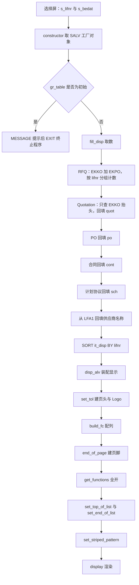
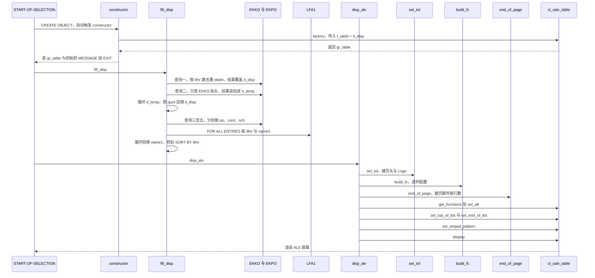

# zmmr_perf_eval_vend（zvend.abap）分析报告

## 一、程序定位与业务背景

**业务场景**：物料管理（MM）里，采购组织定期要给供应商"打分"。`zmmr_perf_eval_vend` 回答的是一个很具体的问题——**在一段过账期间内，某个供应商手上有多少张询价单、多少张已维护的报价、多少张采购订单、多少张合同、多少张计划协议**。这五个数摊在一行上，采购经理就能看出这个供应商卡在采购流程的哪一段：只发询价不下单，或者只走计划协议不走订单。

**为什么需要这样一个报表**：标准 ME2N 是按单据视角组织的，看不到"按供应商横向对比五种单据类型"这种视图；ME80FN 那类绩效报表需要事先配置绩效参数文件，而这里的需求只是"给我一张清单"。作者选择了最直接的实现——对 `EKKO`（采购凭证抬头）按 `bstyp`（单据类型）分段做五次分组计数，再用 SALV ALV 渲染。

**整体设计范式**：一个本地类 `lcl_perf_eval` 把"建对象 → 取数 → 配列 → 页头页脚 → 显示"压成五步流水线，全程序没有 FORM、没有自定义屏幕，是典型的 OO 化单屏报表。

**这份代码的味道**：它不是精心设计的，但也不是一团糟。作者明显熟悉 SALV——`build_fc` 里九次 `get_column` 各自套 `CATCH cx_salv_not_found`，说明他知道列配置在目标系统上会抛异常。取数那一段则是另一回事：五段几乎相同的查询各自漂移出五种不同的过滤口径，这正是这份代码最值得讲的地方。

## 二、程序执行流程总览



**责任链**：

| 子程序 | 调用者 | 职责 |
|---|---|---|
| `START-OF-SELECTION` | 程序入口（选择屏提交） | 建对象，依次调 `fill_disp` 与 `disp_alv` |
| `constructor` | `CREATE OBJECT` 自动触发 | 用工厂方法把 `it_disp` 挂成 SALV 表格；失败则提示并 `EXIT` |
| `fill_disp` | `START-OF-SELECTION` | 五段分组计数取数、名称回填、排序 |
| `disp_alv` | `START-OF-SELECTION` | 装配页头、列、页脚、功能菜单，最后渲染 |
| `set_tol` | `disp_alv` | 建页头（选择条件回显）与 Logo |
| `build_fc` | `disp_alv` | 逐列设置文本、颜色、可见性与技术属性 |
| `end_of_page` | `disp_alv` | 建页脚，显示条目总数 |

下面按这条流程，逐个子程序展开。

## 三、分组分析（按程序流程 / 子程序）

### 3.1 全局声明区：类型、ALV 对象与选择屏

程序一开头就定义了三个内表行类型。`t_disp` 是最终展示的行：供应商号、名称、过账日期，再加五个计数列。

```abap
TYPES:BEGIN OF t_disp,
   lifnr TYPE lifnr,
   name1 TYPE name1_gp,
   bedat TYPE bedat,
   rfq  TYPE I ,
   quot TYPE I ,
   po   TYPE I ,
   cont TYPE I ,
   sch  TYPE I ,
  END OF t_disp,
```

**做什么** — `t_disp` 定义展示行的完整形状：`lifnr` 供应商号、`name1` 名称、`bedat` 过账日期，加上 `rfq`、`quot`、`po`、`cont`、`sch` 五个 `TYPE I` 计数列，整行装进内表 `it_disp` 供 SALV 渲染。

**为什么** — 五个计数列直接平铺在展示行里，而不是先各自存成独立内表再合并。这样 `fill_disp` 只需要一张表，SALV 也能直接吃。代价是这张表同时承担两种职责：既是取数的工作区，又是最终的展示区。

**风险与改进** — `bedat` 被声明在展示行里，但五段取数的字段列表里没有 `bedat`，`it_disp-bedat` 从未被赋值；`build_fc` 又把它 `set_visible( abap_false )` 隐藏掉了。一个恒为初始的列留在展示结构里，读者会误以为这个报表能提供日期维度。建议从 `t_disp` 里删掉，或者在填充阶段真的写进去。

`t_disp` 之外还有两张辅助表 `t_temp`（`lifnr` 加 `CNT`，承载每段查询的聚合结果）和 `t_lfa1`（`lifnr` 加 `name1`），以及一组 ALV 引用对象。选择屏只有两个选择条件：

```abap
SELECTION-SCREEN BEGIN OF BLOCK b1 WITH FRAME TITLE TEXT- 001.
  SELECT-OPTIONS : s_lifnr FOR wa_disp- lifnr,
   s_bedat FOR wa_disp- bedat.
SELECTION-SCREEN END OF BLOCK b1.
```

**做什么** — 一个带标题的选区里声明两个选择条件：`s_lifnr` 绑定 `wa_disp-lifnr`，`s_bedat` 绑定 `wa_disp-bedat`。

**为什么** — 绑定到工作区字段（而不是类型或表行类型）能省事，但把选择条件的类型与内表工作区绑在了一起：改 `t_disp` 的字段类型会连带改选择屏的类型定义。

**风险与改进** — 两个选择条件都没有 `OBLIGATORY`，也没有 `MATCHCODE OBJECT`。留空的选择条件在 `WHERE` 里等价于不限制，所以"什么都不填就 F8"是一份全量扫描请求。这里应该至少给 `s_bedat` 一个默认值，或者在事件里拦截空选择。

### 3.2 `constructor`：取工厂对象，失败即终止

```abap
METHOD constructor.
  TRY.
     cl_salv_table=> factory( IMPORTING r_salv_table = gr_table CHANGING t_table = it_disp ). "Calling Factory Obj of Cl_ALV_TABLE
  CATCH cx_salv_msg.
  ENDTRY .

  IF gr_table IS INITIAL .
    MESSAGE TEXT -002 TYPE 'I' DISPLAY LIKE 'E'.
    EXIT .
  ENDIF .
ENDMETHOD.                   "constructor
```

**做什么** — 用 `cl_salv_table=>factory( )` 把全局的 `it_disp` 挂成 SALV 表格对象 `gr_table`；捕获 `cx_salv_msg`；然后检查 `gr_table` 是否仍为初始，是则发一条 `TEXT-002` 消息并按 `E` 的样式显示，再 `EXIT` 终止程序。

**为什么** — SALV 的工厂方法失败时不返回错误码，而是抛 `cx_salv_msg`；所以这里用 TRY 包住、再用"对象是否为初始"来判定成败，是这套 API 的标准写法。`DISPLAY LIKE 'E'` 让一条信息级消息显示成错误样式，视觉上阻止用户继续。

**风险与改进** — `CATCH cx_salv_msg` 是空的，异常里的错误细节（具体是哪一步、什么参数）全部丢弃，用户只看到 `TEXT-002` 的一句话。而 `TEXT-002` 是否真的维护在程序文本里，在源码上无法验证——如果没维护，`MESSAGE TEXT-002` 本身就会在运行期报错。建议把异常对象接住，至少把它的错误文本拼进消息。另外 `EXIT` 在报表里会直接结束整个会话，若这个类将来被复用，这行会显得非常突兀。

### 3.3 `fill_disp`：五段分组计数取数

这是整份程序的主体，分六步：先取 RFQ 建立行集，再依次回填报价、订单、合同、计划协议，最后补供应商名称并排序。

#### ① 取 RFQ 计数，这一步同时决定了报告的行集

```abap
METHOD fill_disp.
  "RFQ
  SELECT a~lifnr COUNT( DISTINCT a~ebeln ) AS rfq FROM ekko AS a
  JOIN ekpo AS b ON a~ ebeln = b ~ebeln
  INTO CORRESPONDING FIELDS OF TABLE it_disp
  WHERE a~lifnr IN s_lifnr AND bedat IN s_bedat
  AND b~loekz NE 'X'
  AND a~bstyp = 'A'
  GROUP BY a~lifnr .
```

**做什么** — 把 `EKKO`（抬头，别名 `a`）与 `EKPO`（行项目，别名 `b`）按 `ebeln` 内连接，`WHERE` 限定供应商落在 `s_lifnr`、过账日期落在 `s_bedat`、行项目删除标记 `b~loekz` 不等于 `'X'`、单据类型 `a~bstyp` 等于 `'A'`（询价），按 `a~lifnr` 分组数去重后的 `ebeln`，结果装进 `it_disp`。

**为什么** — 用 `COUNT( DISTINCT a~ebeln )` 而不是普通计数，是为了在连接之后去重：一张单据有 N 个行项目，连接出来是 N 行，不去重就会把行数当单据数。这是这份代码里写得对的地方。

**风险与改进** — 两处后果明确的问题。**第一，这里用 `INTO CORRESPONDING FIELDS OF TABLE it_disp` 而不是 `APPENDING`，所以是覆盖写入**：`it_disp` 的行集完全等于这次 RFQ 查询的结果，后面四段回填只能改已有的行。**第二，`WHERE` 里只查了行项目删除标记 `b~loekz`，没有查抬头 `a~loekz`**：一张抬头已删除、但仍有未删除行项目的询价单，会被计进 `rfq` 列。另外因为强制连接 `EKPO`，一张建了但一个行项目都没有的空询价单根本不会出现在结果里——它的 `rfq` 是 0，而业务上应该算 1。

#### ② 回填报价计数：唯一没有兜底分支的那一段

```abap
  "Quot
  SELECT lifnr COUNT( DISTINCT ebeln ) AS CNT FROM ekko
  APPENDING CORRESPONDING FIELDS OF TABLE it_temp
  WHERE lifnr IN s_lifnr AND bedat IN s_bedat
  AND loekz EQ space
  AND ( bstyp = 'A' AND statu = 'A' )
  GROUP BY lifnr.

  LOOP AT it_temp INTO wa_temp .
     wa_disp- lifnr = wa_temp -lifnr.
     wa_disp- quot = wa_temp -CNT.
    MODIFY it_disp FROM wa_disp TRANSPORTING lifnr quot WHERE lifnr = wa_temp-lifnr .
    CLEAR : wa_disp, wa_temp.
  ENDLOOP .
```

**做什么** — 单表查 `EKKO`，条件是抬头删除标记 `loekz` 为空、`bstyp` 等于 `'A'` 且 `statu` 等于 `'A'`（已维护报价），按 `lifnr` 分组数去重单据数，追加进 `it_temp`。然后循环 `it_temp`，把计数写回 `it_disp` 对应行的 `quot` 列。

**为什么** — 报价只查抬头是合理的：`statu` 是抬头字段，行项目不参与判断。这里也不连接 `EKPO`，所以不用担心连接带来的重复。

**风险与改进** — **这段循环是五段回填里唯一没有 `IF sy-subrc NE 0` 兜底的**。`MODIFY ... WHERE lifnr = ...` 在未命中时返回 `sy-subrc NE 0`，而这里直接跳过，接着 `CLEAR wa_disp`。后果是一条：一个供应商只要有报价、但没出现在 RFQ 结果集里（可能是空询价单，也可能是抬头已删除的询价），它的报价计数就整段丢掉——不是显示 0，而是这一行在报表里不存在。叠加 ① 里的行集限制，报价列会系统性偏低。补齐兜底后的写法：

```abap-fix
LOOP AT it_temp INTO wa_temp.
  READ TABLE it_disp INTO wa_disp WITH KEY lifnr = wa_temp-lifnr.
  wa_disp-quot = wa_temp-CNT.
  IF sy-subrc = 0.
    MODIFY it_disp FROM wa_disp TRANSPORTING lifnr quot.
  ELSE.
    CLEAR wa_disp.
    wa_disp-lifnr = wa_temp-lifnr.
    wa_disp-quot = wa_temp-CNT.
    APPEND wa_disp TO it_disp.
  ENDIF.
  CLEAR wa_disp.
ENDLOOP.
```

#### ③ 回填采购订单计数：有兜底，但口径又变了

```abap
  " PO
  REFRESH it_temp.
  SELECT lifnr COUNT( DISTINCT a~ ebeln ) AS CNT FROM ekko AS a JOIN ekpo AS b ON a~ ebeln = b ~ebeln
  APPENDING CORRESPONDING FIELDS OF TABLE it_temp
  WHERE lifnr IN s_lifnr AND bedat IN s_bedat
  AND b~loekz EQ space
  AND bsart NE 'UB'
  AND ( a~ bstyp = 'F' )
  GROUP BY lifnr.

  LOOP AT it_temp INTO wa_temp .
     wa_disp- lifnr = wa_temp -lifnr.
     wa_disp- po = wa_temp -CNT.
    MODIFY it_disp FROM wa_disp TRANSPORTING lifnr po WHERE lifnr = wa_temp-lifnr .
    IF sy-subrc NE 0.
      APPEND wa_disp TO it_disp .
    ENDIF .
    CLEAR : wa_disp, wa_temp.
  ENDLOOP .
```

**做什么** — 刷新 `it_temp`，再查一次 `EKKO` 连接 `EKPO`，条件是行项目未删除（`b~loekz EQ space`）、订单类型 `bsart` 不等于 `'UB'`（退货）、`a~bstyp` 等于 `'F'`（采购订单），分组计数后回填 `po` 列。这一段补上了 ② 缺的 `sy-subrc` 兜底。

**为什么** — `bsart NE 'UB'` 排除退货订单，说明作者知道退货不应该算进"采购量"。兜底分支的存在也说明作者意识到行集可能不全。

**风险与改进** — **口径又不一样了**：① 用的是 `b~loekz NE 'X'`（行项目），② 用的是 `loekz EQ space`（抬头），③ 回到 `b~loekz EQ space`（行项目）。同一个"供应商评估"里，三种删除判定交替出现。而且 `NE 'X'` 与 `EQ space` 在 `EKKO` 与 `EKPO` 的实际取值上也不完全等价——删除标记除了 `' '` 和 `'X'` 还可能取其他值，`NE 'X'` 会把它们也算进来。建议把删除标记的判定抽成一个统一表达式。另外 `TRANSPORTING lifnr po` 里带上 `lifnr` 是多余的（`WHERE` 已经限定了它），无害但会让读者以为 `lifnr` 会被改动。

#### ④ 合同与计划协议：同构的第三、四段

```abap
  "Cont. Created
  REFRESH it_temp.
  SELECT lifnr COUNT( DISTINCT a~ ebeln ) AS CNT FROM ekko AS a JOIN ekpo AS b ON a~ ebeln = b ~ebeln
  APPENDING CORRESPONDING FIELDS OF TABLE it_temp
  WHERE lifnr IN s_lifnr AND bedat IN s_bedat
  AND b~loekz EQ space
  AND ( a~ bstyp = 'K' )
  GROUP BY lifnr.
```

**做什么** — 与 ③ 完全同构，只有 `bstyp` 常量换成 `'K'`（合同），回填 `cont` 列。

**为什么** — 合同通常必须挂行项目，所以连接 `EKPO` 并查重是必要的；过滤条件除了 `bstyp` 之外与订单一致。

**风险与改进** — 与 ③ 的循环体逐字相同，计划协议那一段只差一个常量。四段几乎一样的循环意味着四份拷贝各自漂移——② 漏了兜底就是证明。抽成一个带 `iv_bstyp` 参数的方法，口径才能被统一约束。

```abap
  "Sch Aggre
  REFRESH it_temp.
  SELECT lifnr COUNT( DISTINCT a~ ebeln ) AS CNT FROM ekko AS a JOIN ekpo AS b ON a~ ebeln = b ~ebeln
  APPENDING CORRESPONDING FIELDS OF TABLE it_temp
  WHERE lifnr IN s_lifnr AND bedat IN s_bedat
  AND b~loekz EQ space
  AND ( a~ bstyp = 'L' )
  GROUP BY lifnr.
```

**做什么** — 第四段，`bstyp` 等于 `'L'`（计划协议），回填 `sch` 列。

**为什么** — 计划协议与合同走同样的单据结构，所以过滤条件也一致。

**风险与改进** — 这里有一个值得注意的空白：计划协议同样存在 `bsart` 为 `'UB'` 的变更单，但这一段没有像 ③ 那样排除它。如果业务上需要区分"新增计划协议"和"变更计划协议"，这一列会把两者混在一起。这一点依赖 `EKPO` 的 `bsart` 取值语义，需要回 SE11 核实。

#### ⑤ 补供应商名称并排序

```abap
  SELECT lifnr name1 FROM lfa1
  INTO CORRESPONDING FIELDS OF TABLE it_lfa1
  FOR ALL ENTRIES IN it_disp
  WHERE lifnr = it_disp -lifnr.

  LOOP AT it_disp INTO wa_disp .
    READ TABLE it_lfa1 INTO wa_lfa1 WITH KEY lifnr = wa_disp-lifnr .
    IF sy-subrc EQ 0.
       wa_disp- name1 = wa_lfa1 -name1.
      MODIFY it_disp FROM wa_disp TRANSPORTING lifnr name1 WHERE lifnr = wa_disp- lifnr .
    ENDIF .
  ENDLOOP .


  SORT it_disp BY lifnr .

ENDMETHOD.                   "fill_disp
```

**做什么** — 从 `LFA1` 按当前 `it_disp` 的行集取 `lifnr` 与 `name1` 装进 `it_lfa1`，然后循环 `it_disp` 用 `READ TABLE ... WITH KEY` 逐行回填 `name1`；最后 `SORT it_disp BY lifnr`。

**为什么** — `FOR ALL ENTRIES` 把 N 次单表查询合成一次，是标准做法；单独取一张窄表（只两列）再回填，比在那五段查询里带上 `name1` 干净——因为那五段都带着分组计数，多带一个非聚合列会破坏聚合语义。

**风险与改进** — **`FOR ALL ENTRIES IN it_disp` 没有判空保护**：`it_disp` 为空时，这个子句会退化成一条不带 `WHERE` 的查询，把整个 `LFA1` 供应商主数据表读进来。前面几处 `LOOP AT it_temp` 在空表时天然不进入循环，是安全的；这里是唯一一处会失控的取数。`it_lfa1` 声明成标准表，内层 `READ TABLE ... WITH KEY` 每次都是线性查找，供应商多时又是二次复杂度。

### 3.4 `build_fc`：逐列配置

```abap
METHOD build_fc.

  INCLUDE <color>.
  TRY.
     gr_columns = gr_table->get_columns ( ).
     gr_columns-> set_optimize( abap_true ).
     gr_column ?= gr_columns-> get_column( 'LIFNR' ).
     ls_color- col = 3 .
     gr_column-> set_color( ls_color ).

  CATCH cx_salv_not_found.
  ENDTRY .
```

**做什么** — 取列集合，打开 `set_optimize( abap_true )`，然后逐列取 `LIFNR` 并用 `ls_color- col = 3`（红色）染色，`NAME1` 设长文本与短文本，`BEDAT` 设为不可见且技术字段，`RFQ`、`QUOT`、`PO`、`CONT`、`SCH` 各设短文本与中长度文本。

**为什么** — 每一列都包在自己的 TRY 与 `CATCH cx_salv_not_found` 里，因为 `get_column` 在列名不存在时会抛异常。这是这份代码最见功力的地方：作者很清楚 SALV 在目标系统上的脆弱性，并且用九次独立的捕获把失败隔离到单列。`set_optimize` 让 SALV 自动隐藏当前用不到的列。

**风险与改进** — 开头的 `INCLUDE <color>.` 不是可编译的 ABAP：`INCLUDE` 语句的语法是 `INCLUDE` 后跟一个程序名，而 `<color>` 既不是程序名也不是合法标识符。这一行读起来像是从某个模板或网页渲染里抄进来的残留。源码里确实存在这一行，但**它是否被注释掉、目标系统是否允许通过编译，必须回 SE38 核实**——从源码文本本身定不了结论。另外 `ls_color- col = 3` 给供应商号和名称都上了红色，这与"供应商评估"里通常期望的"红色代表风险"语义正好相反，容易误导阅读。

```abap
  TRY.
     gr_column ?= gr_columns-> get_column( 'BEDAT' ).
     gr_column-> set_visible( abap_false ).
     gr_column-> set_technical( VALUE = if_salv_c_bool_sap=> true ).
  CATCH cx_salv_not_found.
  ENDTRY .
```

**做什么** — 取 `BEDAT` 列，`set_visible( abap_false )` 隐藏，再 `set_technical` 标记为技术字段。

**为什么** — `bedat` 在 `t_disp` 里是选择屏的绑定字段，必须在结构里存在；但五段取数从来不写它，所以它在展示里恒为空。作者选择把它藏起来而不是删掉。

**风险与改进** — 隐藏是合理的止血，但页头 `set_tol` 里却会把 `s_bedat` 回显成 `Posting Date` 加区间。用户看到的是一行"过账日期"标签，而表里对应的那列是空的——回显的是选择值，不是数据。建议在页头文案上说明这是筛选条件，或者干脆把 `bedat` 从 `t_disp` 里移除。

### 3.5 `disp_alv`：装配与渲染

```abap
METHOD disp_alv.

   set_tol( ).
   build_fc( ).
   end_of_page( ).

   gr_functions = gr_table->get_functions ( ).
   gr_functions-> set_all( abap_true ).
   gr_table-> set_top_of_list( lr_logo ).
   gr_table-> set_end_of_list( lr_footer ).
   gr_display = gr_table->get_display_settings ( ).
   gr_display-> set_striped_pattern( cl_salv_display_settings =>true ).


   gr_table-> display( ).

ENDMETHOD.                   "disp_alv
```

**做什么** — 依次调 `set_tol`、`build_fc`、`end_of_page` 建好页头、列配置与页脚，然后取功能菜单并 `set_all( abap_true )` 全开，把 `lr_logo` 与 `lr_footer` 挂成表格的头尾，打开斑马纹，最后渲染。

**为什么** — 先把所有"构造"做完，再做一次性的"装配"，最后渲染。这是 SALV 的标准节奏：`set_top_of_list` 与 `set_end_of_list` 必须在 `display` 之前调用才生效。

**风险与改进** — 三个构造方法被写成了全局对象的隐式契约：`set_top_of_list( lr_logo )` 依赖 `set_tol` 里的 `CREATE OBJECT lr_logo`，`set_end_of_list( lr_footer )` 依赖 `end_of_page` 里的 `CREATE OBJECT lr_footer`。调用顺序一旦颠倒就是空引用，而源码里没有任何机制阻止这件事——`disp_alv` 只是恰好按正确顺序写了三行。建议让 `set_tol` 与 `end_of_page` 各自完成自己的装配，把结果作为参数返回，而不是只负责在全局变量里建对象。

### 3.6 `set_tol`：页头与 Logo

```abap
METHOD set_tol.
  DATA : lv_text( 30) TYPE C ,
         lv_date TYPE C LENGTH 10.

  CREATE OBJECT lr_grid.

   lr_grid-> create_header_information( row = 1 column = 1
  TEXT = 'MM: Vendor Evaluation'
   tooltip = 'MM: Vendor Evaluation' ).
```

**做什么** — 声明两个定长字符串 `lv_text`（30 字符）与 `lv_date`（10 字符），建 `lr_grid`，在第一行第一列创建标题 `MM: Vendor Evaluation`。

**为什么** — 页头用 SALV 的表格布局手搭，每一行都是"标签加文本"两列。标题做成一行是惯例。

**风险与改进** — `lv_text( 30) TYPE C` 是定长字符串，超出 30 字符会静默截断。当前供应商号 10 位、日期 10 位，拼接后约 21 字符，放得下；但这是个没有余量的假设——任何前缀或更长的日期格式都会吃掉尾部。建议改成 `TYPE string`，或者把长度放到 80。

```abap
   IF s_bedat IS NOT INITIAL .
     WRITE s_bedat-low DD/MM/YYYY TO lv_text .
     IF s_bedat-high IS NOT INITIAL.
       WRITE s_bedat-high DD/MM/YYYY TO lv_date.
       CONCATENATE lv_text ' to ' lv_date INTO lv_text SEPARATED BY space.
     ENDIF .
  ELSE .
     lv_text = 'Not Provided'.
  ENDIF .
```

**做什么** — 如果 `s_bedat` 有值，把下限按 `DD/MM/YYYY` 写进 `lv_text`，若上限也有值则格式化成 `lv_date` 并拼成"下限 to 上限"；否则写 `Not Provided`。

**为什么** — 页头要回显用户的选择条件，让用户确认自己看的是哪个区间。空选择时明确写 `Not Provided` 而不是留空，比默认当成全量更诚实。

**风险与改进** — 这个"诚实"只做到了一半：`Not Provided` 写在了页头，但报表并没有因此拒绝运行。选择条件为空时，五段查询照样按全量 `EKKO` 与 `EKPO` 跑完，用户拿到的是一份"我没有筛选"的全量结果，而页头那行字不足以让人立刻意识到这一点。这里应该配合一个确认消息或直接拦截。另外这里只取了 `s_bedat-low`，若用户只填了上限（区间从空到某日），页头只显示上限而丢掉了"从最开始"的语义。

```abap
* Create logo layout, set grid content on left and logo image on right
  CREATE OBJECT lr_logo.
   lr_logo-> set_left_content( lr_grid ).
   lr_logo-> set_right_logo( 'ZCHEM_N_LOGO_SMALL' ). " Image From OAER T.code
```

**做什么** — 建 `lr_logo`，左边放页头表格 `lr_grid`，右边放图形对象 `ZCHEM_N_LOGO_SMALL`。

**为什么** — SALV 的 Logo 布局就是"左内容加右图形"，把标题、选择条件回显和 Logo 拼成一个页头块。

**风险与改进** — **图形对象名硬编码成字符串字面量，而且这个调用点外面没有任何 TRY。** 同一个类里，`build_fc` 给九次 `get_column` 都套了 `CATCH cx_salv_not_found`，说明作者知道目标系统缺对象会抛异常；唯独这张 Logo 没套。`ZCHEM_N_LOGO_SMALL` 是跨系统对象，注释里说它来自 OAER TCode——目标系统如果没导入这个图形，异常会在 `set_tol` 里抛出，`disp_alv` 没有捕获，用户看到的是短转储或空白屏幕，而不是"报表少了个 Logo"。建议：

```abap-fix
TRY.
  lr_logo->set_right_logo( 'ZCHEM_N_LOGO_SMALL' ).
CATCH cx_salv_exception INTO lx_salv.
  CLEAR lx_salv.
ENDTRY.
```

### 3.7 `end_of_page`：页脚与条目总数

```abap
METHOD end_of_page.

  DATA :lf_lines TYPE sy-tfill .

  DATA : "lr_label TYPE REF TO cl_salv_form_label,
         lf_flow TYPE REF TO cl_salv_form_layout_flow .

  CREATE OBJECT lr_footer.
*--get total lines in internal table
   lf_lines = LINES( it_disp ).
```

**做什么** — 声明 `lf_lines`（类型 `sy-tfill`）与 `lf_flow`，建 `lr_footer`，用 `LINES( it_disp )` 取展示表的行数。

**为什么** — 页脚要显示"这次查出了多少条供应商"，`LINES( )` 是取内表行数的标准函数。这里取的是填充并排序完成之后的行数，所以数字是最终行数。

**风险与改进** — `lf_lines TYPE sy-tfill` 在类型上够用（`LINES( )` 返回 `i`，`sy-tfill` 也是 `i` 长度 5），但用 `sy-tfill` 表达"计数"属于语义误用：`sy-tfill` 描述的是系统字段 `SY-TFILL`（表填充计数），把它当地变量类型读起来像是在暗示与系统字段有关联。写 `TYPE i` 更清楚，读者不会多想。

### 3.8 `START-OF-SELECTION`：入口

```abap
START-OF-SELECTION.
DATA : obj_rep TYPE REF TO lcl_perf_eval. " Declaring Object for Class

CREATE OBJECT : obj_rep. " Creating Object

obj_rep->fill_disp( ). " Calling class Methods
obj_rep->disp_alv( ).
```

**做什么** — 建 `lcl_perf_eval` 实例，依次调 `fill_disp`（取数）与 `disp_alv`（显示）。构造函数在 `CREATE OBJECT` 时自动执行，所以 SALV 工厂对象在这之前就建好了。

**为什么** — 入口只做三件事：建对象、取数、显示。职责清晰，没有把业务逻辑散在事件块里。

**风险与改进** — 整段没有一处 `AUTHORITY-CHECK`，`fill_disp` 与 `disp_alv` 之间也没有任何失败检查：如果 `fill_disp` 的某段查询抛出数据库异常，`disp_alv` 不会执行，用户只看到一个短转储。更重要的是权限——见第五节 P0-3。这里也是应该加选择条件拦截和对象级权限检查的地方。

## 四、执行流程全景图（数据视角）



## 五、问题清单与改进建议（按优先级）

### 🔴 P0 业务正确性

| 编号 | 问题 | 所在 | 业务后果 |
|---|---|---|---|
| P0-1 | 报价回填是唯一没有 `IF sy-subrc NE 0` 兜底的循环，而行集又完全由 RFQ 查询决定 | `fill_disp` | 有报价但没出现在 RFQ 结果集里的供应商，报价计数整段丢失，报表上这一行不存在 |
| P0-2 | 五段计数用五种过滤口径：`b~loekz NE 'X'`、`loekz EQ space`、`b~loekz EQ space`，`statu` 只在报价段出现 | `fill_disp` | `rfq` 列与 `quot` 列在数值上不可比，所谓"询价到报价的漏斗"其实不存在 |
| P0-3 | 全文零处 `AUTHORITY-CHECK`，`s_lifnr` 与 `s_bedat` 都可留空 | `START-OF-SELECTION` | 采购组织与供应商组之间无任何权限隔离：任何能运行该事务的用户都能越权看到全量供应商的单据计数分布，属于典型的数据权限与 SoD（职责分离）缺口 |
| P0-4 | RFQ 段只查行项目删除标记，不查抬头 `a~loekz`，且强制连接 `EKPO` | `fill_disp` | 抬头已删除但行项目未删除的询价被计入 `rfq`；反之空询价单完全不计入 |

### 🟠 P1 健壮性

| 编号 | 问题 | 所在 | 业务后果 |
|---|---|---|---|
| P1-1 | Logo 图形名 `ZCHEM_N_LOGO_SMALL` 硬编码，调用点不在任何 TRY 里，而同类的九次 `get_column` 都套了 `CATCH cx_salv_not_found` | `set_tol` | 目标系统缺图形对象时在渲染前抛异常，用户看到短转储而不是缺 Logo 的报表 |
| P1-2 | `FOR ALL ENTRIES IN it_disp` 没有判空，`it_disp` 为空时退化成不带 `WHERE` 的查询 | `fill_disp` | 选择条件筛出零行时会把整个 `LFA1` 供应商主数据读进来 |
| P1-3 | `CATCH cx_salv_msg` 是空的，失败细节全部丢弃，只发一条 `TEXT-002` | `constructor` | 工厂方法失败时无法定位原因；`TEXT-002` 若未维护在程序文本里，`MESSAGE` 本身会运行期报错 |
| P1-4 | `set_top_of_list` 与 `set_end_of_list` 依赖 `set_tol` 与 `end_of_page` 隐式创建 `lr_logo` 与 `lr_footer` | `disp_alv` | 调用顺序颠倒就是空引用，源码里没有任何机制阻止 |

### 🟡 P2 性能与规范

| 编号 | 问题 | 所在 | 业务后果 |
|---|---|---|---|
| P2-1 | `it_disp` 与 `it_lfa1` 都是标准表，六段 `MODIFY ... WHERE lifnr =` 与 `READ TABLE ... WITH KEY` 全走线性查找 | `fill_disp` | 供应商清单长时取数是二次复杂度，宽区间选择下明显变慢 |
| P2-2 | 五个计数查询高度同构却各写一份 | `fill_disp` | 四份拷贝各自漂移出口径差异，P0-2 与 P0-4 正是这样产生的 |
| P2-3 | 页头 `Posting Date` 回显的是选择值，而表里的 `bedat` 列恒为空并被 `set_visible( abap_false )` 隐藏 | `set_tol` | 用户以为表里有日期维度，实际没有 |
| P2-4 | `lv_text( 30) TYPE C` 用定长承接区间文字 | `set_tol` | 供应商号加日期的区间串目前约 21 字符，无余量，格式化改动会静默截断 |
| P2-5 | `SORT it_disp BY lifnr` 之后 SALV 仍按自己的规则再排一次 | `fill_disp` | 排序做了两遍，且第一遍的结果没被用于任何索引优化 |
| P2-6 | `ls_color- col = 3` 把供应商号与名称都染成红色 | `build_fc` | 与"红色代表风险"的常见阅读习惯相反，容易误导 |

### 🟢 P3 可扩展性

| 编号 | 问题 | 所在 | 业务后果 |
|---|---|---|---|
| P3-1 | `INCLUDE <color>.` 不是合法 ABAP 语法 | `build_fc` | 疑似模板残留，是否可编译需回 SE38 核实 |
| P3-2 | 页头用四次不带 `TEXT` 的 `create_label` 占位来推 Logo 位置 | `set_tol` | 布局逻辑写在坐标数字里，改一行要重排四个占位 |
| P3-3 | 全局持有 `lr_grid`、`lr_gridx`、`lr_logo`、`lr_label`、`lr_text`、`lr_footer` 六个引用对象 | 全局声明区 | `lr_grid` 与 `lr_gridx` 类型完全相同，且跨方法共享状态 |
| P3-4 | 取数硬编码五个 `bstyp` 常量，无法扩展 | `fill_disp` | 想加"服务订单"等新类型要再抄一段查询 |

## 六、整体评价与启发

**优点**

1. **对 SALV 的脆弱性判断准确。** `build_fc` 里九次独立的 TRY 加 `CATCH cx_salv_not_found` 是这份代码最专业的一处——`get_column` 在列名不存在时会抛异常，用九次独立捕获把失败隔离到单列，比一个大 TRY 包住全部要稳得多。
2. **`COUNT( DISTINCT a~ebeln )` 用对了。** 五段连接查询都需要在去重之后再计数，作者每次都写对了，没有把行数当单据数。
3. **展示结构与取数结构分离。** `it_temp` 只装两列聚合结果，名称单独从 `LFA1` 取，避免在带分组计数的查询里多带一个非聚合列。
4. **入口干净。** `START-OF-SELECTION` 只做建对象、取数、显示三件事，业务逻辑没有散落在事件块里。

**短板**

1. 取数是五份拷贝，漂移出的口径差异直接变成了 P0 级业务错误。
2. 行集由第一段查询决定，后面四段只能改不能增——这个设计让"漏行"成为结构性缺陷，而不是某一段的疏忽。
3. 权限完全依赖事务代码级授权，没有任何对象级检查，也没有选择条件拦截。
4. 页头回显的诚意只做到文字，没做到行为：写了 `Not Provided` 却不拒绝运行。

**可学到的设计经验**

1. **同构逻辑必须收口。** 五段几乎相同的查询，差异只有 `bstyp` 一个常量，写成方法加参数就能让口径统一。四份拷贝各自漂移，是这份代码所有 P0 的共同来源。
2. **SALV 的异常要按对象粒度捕获。** 这份代码对列做了，对 Logo 没做——差的就是那一层 TRY。
3. **`MODIFY ... WHERE` 的 `sy-subrc` 必须处理。** 三处处理了，一处漏了，漏的那一处正是最严重的业务缺陷。
4. **展示结构里的列必须有意义。** 一个恒为初始又被隐藏的字段留在行类型里，读者会误判这个报表能提供什么维度。
